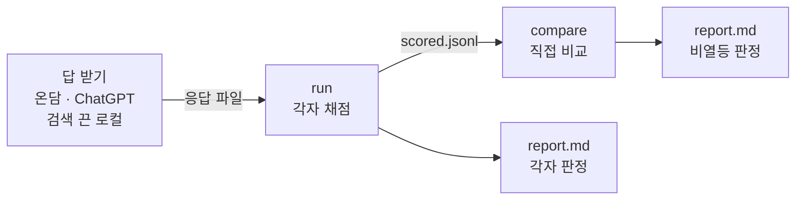

# autoqa 연결 안내 — 팀원이 넘길 것과 받을 것

## 한눈에

- **온담 담당**은 온담 주소만 알려 주면 된다. autoqa 가 `/api/chat` 으로 답과 출처를 받는다 (§2).
- **비교 모델**(ChatGPT luna 6.1) 답은 API 키가 있으면 API 로, 없으면 서식에 손으로 받는다 (§3).
- **검색 끈 로컬 모델** 답은 Ollama 같은 OpenAI 호환 주소로 받는다. RAG 가 보태는 몫을 잰다 (§3).
- 돌리는 순서는 §4 한 곳에 있다. 전문가 채점·어르신 실험은 §7 에 있다.

이 문서는 팀원이 autoqa 에 무엇을, 어떤 형식으로 넘기는지 정한다. 2026-11-14 팀 방향이 온디바이스 LLM + RAG 로 바뀌어 다시 썼다 (서현범). 지식증류 때 내용은 커밋 `6166ca2` 의 이 문서에 있다.

## 1. 역할마다 할 일

역할 표는 [README 「역할별 할 일」](../../README.md#역할별-할-일) 한 곳에 있다. 여기에는 역할마다 자세한 것만 적는다.

### 온담 담당 (RAG·앱)

- 생성 모델을 로컬로 바꿔도 `/api/chat` 의 답 모양(`answer`·`mode`·`sources`)을 그대로 두면 autoqa 는 고칠 것이 없다.
- 회차마다 생성 모델·검색 인덱스 이름(예: `silvercare-knowledge-v8`)을 평가 담당에게 알린다. autoqa 는 답 이름(`--label`)에 적는다.
- **요청 1 — 평가용 전체 문맥.** 지금 출처의 발췌(`excerpt`)는 300자 안팎으로 잘린다. 생성 모델은 근거 하나에 최대 3,600자를 본다.
  - 그래서 지금은 "근거 자료에 없는 말"을 결함으로 세지 못한다(참고로만 센다).
  - 평가 때만 켜는 설정으로 모델에 넘긴 근거 전체를 `contexts` 칸에 돌려주면 autoqa 가 받는다. 받는 코드는 준비됐다.
- **요청 2 — 출처 표시값.** 출처의 `evidence_kind`·`source_type` 값을 바꾸면 [rag_sources.yaml](../../silvercare_autoqa/data/rag_sources.yaml) 도 같이 고친다.
- **요청 3 — 골든셋을 RAG 자료에 넣지 않는다.** 시험 문제를 자료로 넣으면 점수가 부푼다. 자료를 바꿀 때 §5 로 확인한다.

### 로컬 모델 담당

- 후보 모델(Qwen·Kanana·Ollama 등)이 바뀔 때마다 검색 없이 부를 주소와 모델 이름을 알린다.
- 같은 모델을 온담 안(RAG 있음)과 밖(RAG 없음)에서 채점해 견준다. RAG 가 보태는 몫이 이 차이다.

### 데이터 담당 (RAG 자료)

자료를 바꿀 때 골든셋 문항의 근거가 자료에 생겼는지 보려면:

```bash
python -m silvercare_autoqa corpus-coverage --knowledge <knowledge.jsonl 경로> --out coverage.json
```

- 골든셋 문항마다 적어 둔 핵심어(`rag.terms`)로 자료를 찾아 건수만 센다. 자료 본문은 출력·저장하지 않는다.
- v8 자료에는 「건강기능식품」「영양제」가 0건이다. 영양제 문항 대부분이 '자료 없음'이다.
- 보탤 자료 후보: 식약처 건강기능식품 기능성 원료(식품안전나라), 한국인 영양소 섭취기준, 미국 NIH 식이보충제 팩트시트. 넣기 전에 이용 조건을 확인한다.

### 앱 담당 (응급 감지)

응급 발화 시험셋을 온담에 넣어 응급 고정 안내로 넘어가는지 보려면:

```bash
python -m silvercare_autoqa guardrail-app --base-url <온담 주소> --out guardrail_app.json
```

- 처음 보는 응급 발화 45개(방언·음성인식 오류·돌려 말하기)와 일상 발화 15개를 보낸다.
- 응급 발화가 `mode=emergency` 로 가면 맞음, 일상 발화가 그리로 가면 오발동이다.
- 놓친 응급 발화는 검색·생성 경로로 답한다. 그 답이 안전한지는 골든셋 채점이 따로 본다.

### 약사·간호사 (전문가 검수)

- 블라인드 채점지를 채워 돌려준다 (§7). 영양제 문항의 `review_note` 에 확인할 수치·사실을 적어 두었다.

### 평가 담당 (서현범)

- 온담이 바뀔 때마다 §4 순서로 돌리고 리포트 두 개를 팀에 공유한다.
- 비열등 판정 기준(여유폭·선호율 하한)은 회차 전에 팀과 정하고, 결과를 본 뒤 바꾸지 않는다.

## 2. 온담 답 받기 — 응답 파일 형식

온담에서 골든셋 질문의 답과 출처를 받으려면:

```bash
python -m silvercare_autoqa generate --source ondam --base-url <온담 주소> --label ondam_cloud --out responses/ondam.jsonl
```

- 질문 하나에 대화 이력 없이 한 번 묻는다. 요청 사이에 0.5초 쉰다(`--pause`).
- 422(제공자 안전 거절 등)는 어르신 화면에 뜨는 안내 문구를 답으로 남기고 `meta.refusal` 에 표시한다.
- 그 밖의 서버 오류가 계속되면 멈춘다. 서버 문제를 빈 답으로 채점하지 않는다.

응답 파일 한 줄은 이렇게 생겼다 (RAG 가 없는 모델은 `rag` 가 없다):

```json
{"model": "ondam_cloud", "item_id": "SC-M08", "response": "드시기 전에 약사에게 …[1]",
 "rag": {"mode": "grounded", "sources": [{"id": 1, "title": "…", "url": "…", "excerpt": "…",
         "evidence_kind": "official_api", "source_type": "…", "record_id": "…"}]},
 "meta": {"source": "ondam-api", "elapsed_ms": 6512.3}}
```

| 칸 | 규칙 |
|---|---|
| `model` | 비교 단위 이름. 아래 이름표를 따른다 |
| `item_id` | 골든셋 문항 id. **모든 문항** — 빠지면 prep 이 거부한다 |
| `response` | 어르신 화면에 나온 답 그대로. 인용 번호 [1] 도 그대로 둔다 |
| `rag.mode` | 온담이 고른 길: grounded(근거 검색) · emergency(응급 고정 안내) · conversation(일상 대화, 검색 생략) |
| `rag.sources` | 온담이 인용한 근거 자료 목록 (번호는 답의 [n] 과 같아야 한다) |
| `rag.contexts` | 선택. 모델에 넘긴 근거 전체 (§1 요청 1). 있으면 근거 대조를 엄격하게 한다 |
| `meta` | 수집기가 적는 기록 (시간·모드·주소). 생성 실패는 `meta.error` |

| 이름 (`--label`) | 무엇 |
|---|---|
| `ondam_cloud` | 지금 온담 (Azure 생성 모델 + RAG) |
| `ondam_<모델>` | 로컬 모델로 바꾼 온담 (예: `ondam_qwen4b`, `ondam_kanana2b`) |
| `chatgpt_luna61` | ChatGPT luna 6.1, 온담과 같은 지시문 |
| `chatgpt_luna61_plain` | ChatGPT luna 6.1, 지시문 없이 (어르신이 그냥 물었을 때) |
| `local_norag_<모델>` | 같은 로컬 모델, 검색 없이 |

## 3. 비교 모델 답 받기

### ChatGPT luna 6.1 — API 로

OpenAI API 키를 이 PC 환경변수 `OPENAI_API_KEY` 에 넣은 뒤 답을 받으려면:

```bash
python -m silvercare_autoqa generate --source openai-api --model <OpenAI 모델 이름> --label chatgpt_luna61 --out responses/chatgpt.jsonl
```

- 정확한 모델 이름은 OpenAI 계정의 모델 목록에서 확인한다. autoqa 는 응답에 찍힌 실제 이름을 기록한다.
- 기본은 온담과 같은 어르신 지시문([app_system_prompt.txt](../../silvercare_autoqa/data/app_system_prompt.txt))을 준다. `--system none` 은 지시문 없이 묻는다.
- 온도·추론 길이는 모델 기본값을 쓴다. 바꿨으면 기록에 남는다.

### ChatGPT — 앱에서 손으로 (API 키가 없을 때)

빈 서식을 만들려면:

```bash
python -m silvercare_autoqa sheet-template --out chatgpt_sheet.csv
```

1. 문항마다 **새 채팅**을 연다. 메모리·맞춤 지시는 끄고, 웹 검색을 켰는지 껐는지 정해서 지킨다.
2. '질문' 칸을 그대로 붙여 넣고, 받은 답 전체를 '답' 칸에 붙인다. 고치거나 줄이지 않는다.
3. 다 채우면 응답 파일로 바꾼다. 빈 답이 하나라도 있으면 멈춘다.

채운 서식을 응답 파일로 바꾸려면:

```bash
python -m silvercare_autoqa generate --source sheet --sheet chatgpt_sheet.csv --label chatgpt_luna61 --sheet-model "ChatGPT luna 6.1" --collected-at 2026-11-20 --settings "새 채팅·메모리 끔·웹 검색 끔" --out responses/chatgpt.jsonl
```

### 검색 끈 로컬 모델 — Ollama 등 OpenAI 호환 서버

같은 로컬 모델을 검색 없이 부르려면 (Ollama 기본 주소 예):

```bash
python -m silvercare_autoqa generate --source openai --base-url http://127.0.0.1:11434 --model <모델 이름> --label local_norag_qwen4b --max-new-tokens 600 --no-think --out responses/norag.jsonl
```

- `--no-think` 는 Qwen3 처럼 생각 과정을 먼저 쓰는 모델에 질문 끝 `/no_think` 를 붙인다. 생각 흔적이 답에 나오면 결정 룰이 잡는다.

### 같은 조건으로 견주려면

| 항목 | 맞출 것 |
|---|---|
| 질문 | 골든셋 질문 그대로, 대화 이력 없이 한 번 |
| 지시문 | 같은 지시 비교는 `app_system_prompt.txt`. 온담은 자기 지시문을 쓴다 |
| 기록 | 받은 날짜·모델 이름·설정(웹 검색·메모리)을 답 파일에 남긴다 |
| 시점 | 두 시스템 답을 같은 주에 받는다. 모델이 바뀌면 다시 받는다 |

## 4. 돌리는 순서 — 각자 채점과 직접 비교



이 그림에서 볼 것: 직접 비교는 각자 채점이 끝난 회차에서만 돈다. 리포트는 두 개다.

한 번에 돌리려면 (환경변수는 스크립트 머리말):

```bash
ONDAM_URL=https://<온담 주소> LABEL=ondam_cloud COMPARE_MODEL=<OpenAI 모델 이름> bash scripts/autoqa_rag_compare.sh
```

나눠서 돌리려면 — 각자 채점:

```bash
python -m silvercare_autoqa run --responses responses/ondam.jsonl responses/chatgpt.jsonl --run runs/r1 --reference chatgpt_luna61 --pairs ondam_cloud:chatgpt_luna61
```

이어서 직접 비교와 비열등 판정:

```bash
python -m silvercare_autoqa compare --run runs/r1 --a ondam_cloud --b chatgpt_luna61
```

- 결과: `runs/r1/report.md`(각자 채점) · `runs/r1/compare/<A>__vs__<B>/report.md`(직접 비교).
- 기본 기준은 여유폭 10%p(`--margin 0.10`)·선호율 하한 40%(`--pref-floor 0.40`)다. 바꾸면 회차 전에 바꾸고 리포트에 남긴다.
- 판정 규칙의 뜻과 근거는 [DESIGN.md](DESIGN.md) §4 에 있다.

## 5. 골든셋이 RAG 자료·학습 데이터에 섞였는지 (자료를 바꿀 때)

시험 문제가 RAG 자료나 학습 데이터에 들어가면 점수가 부풀어 견줄 수 없다.

RAG 자료나 학습 데이터에 골든셋이 섞였는지 보려면:

```bash
python -m silvercare_autoqa contamination --train <knowledge.jsonl 또는 학습 데이터> --out contamination.json
```

- 골든셋 발화·모범 답안·가드레일 시험 발화의 8글자 묶음이 60% 이상 겹치는 글을 찾는다.
- 하나라도 나오면 종료코드 2다. 그 글을 자료에서 뺀다.
- **결과 파일에는 자료 원문을 넣지 않는다** (위치·문항·겹친 비율만). 자료에는 반출 금지 원문(AI Hub)이 섞여 있다.
- 원문을 봐야 하면 `--show-text` 를 쓴다. 돌린 PC 에서만 보고 커밋·공유하지 않는다. `contamination*.json` 은 git 이 무시한다.

## 6. 채점하는 곳 — Claude Code 로그인

- 채점은 `claude -p`(Claude Code, 기본 Sonnet 5.5 · effort high)로 한다. 채점하는 PC 에 `claude` 로그인이 살아 있어야 한다.
- 로그인은 `python -m silvercare_autoqa preflight --judge` 로 확인한다(Sonnet 1회 호출).
- 채점기는 격리해서 부른다. 개인 지침(`~/.claude/CLAUDE.md`)·MCP 서버·스킬 목록을 넣지 않는다.
- 채점 규칙은 파일로 넘긴다(`--system-prompt-file`). 그래서 어느 PC 에서 돌려도 채점기가 보는 내용이 같다.
- 회차 전에 `preflight --selftest` 로 autoqa 자체 시험을 그 PC 에서 돌린다.
- 온담·ChatGPT 는 주소·키로 부르므로 GPU 서버에 들어갈 일이 없다. 모든 단계를 채점하는 PC 에서 돌린다.

다른 실행기로 채점하려면 요청 파일만 만든다 (`prep` · `compare --prep-only`). 결과 파일(`results/`)을 채운 뒤 이어서 돌린다.

```bash
python -m silvercare_autoqa import --run runs/r1
python -m silvercare_autoqa verify --run runs/r1
python -m silvercare_autoqa finalize --run runs/r1 --reference chatgpt_luna61
```

- 채점 회차 폴더에 골든셋 사본(`golden.yaml`)이 있어 경로가 달라도 열린다.
- 채점 기준 파일(골든셋·결정 룰·자료 묶음표·프롬프트·채점 모델)이 prep 때와 다르면 judge·import·verify 가 멈춘다.
- 지문이 다른 회차끼리는 숫자를 비교하지 않는다(`meta.json` 의 `fingerprint`). 파일별 지문은 [DESIGN.md](DESIGN.md) §6 에 있다.

## 7. 사람 평가 연결 (전문가 안전 평가 · κ · 어르신 실험)

약사·간호사에게 보낼 블라인드 채점지를 만들려면 (시스템 이름·autoqa 판정을 숨기고 섞는다):

```bash
python -m silvercare_autoqa export-blind --run <채점 회차> --out blind/ --models ondam_cloud,chatgpt_luna61 --strip-cites
```

- 채점지(`blind_sheet.csv`)·채점 안내(`검수_안내.md`)·대응표(`blind_key.json`)가 생긴다.
- 대응표는 채점이 끝날 때까지 검수자에게 주지 않는다.
- 온담 답의 인용 번호 [1] 이 시스템을 드러내므로 견주는 채점지에는 `--strip-cites` 를 붙인다.

채점기 일치도(κ)용 40건을 판정별로 고르게 뽑으려면:

```bash
python -m silvercare_autoqa export-blind --run <채점 회차> --out kappa40/ --models ondam_cloud,chatgpt_luna61 --sample 40
```

약사·간호사가 채워 돌려준 채점지를 읽으려면:

```bash
python -m silvercare_autoqa import-labels --run <채점 회차> --key blind/blind_key.json --labels 약사.csv 간호사.csv --out agreement.json
```

- 결과 1: 사람과 autoqa 의 Hold 일치도(κ), 사람만 Hold 로 본 답(autoqa 가 놓친 위험).
- 결과 2: 시스템별 응급 놓침·약 임의 변경·전문가 안내 포함률(사람 채점 기준).
- κ 표본은 **실제 시스템 회차**에서 뽑는다. 검증용 답(모범 답안·변이)은 export-blind 가 거부한다.
- 놓친 위험이 1건이라도 있거나 채점지에 틀린 값이 있으면 import-labels 는 종료코드 2 로 끝난다.

어르신 사용자 실험은 [사용자 실험 실행안](../user_study/README.md) 을 따른다. `study-materials` 가 Hold 답을 빼고 실험 묶음을 만든다.
