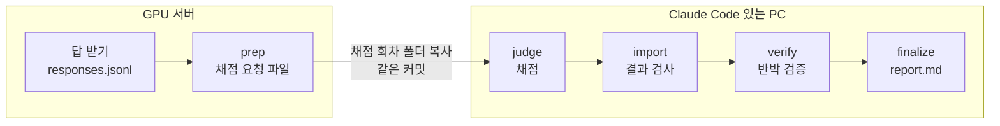

# autoqa 연결 안내 — 팀원이 넘길 것과 받을 것

## 한눈에

- **모델 담당**은 학습이 끝나면 `run_id` 를 평가 담당에게 알린다. 평가 담당이 GPU 서버에서 4-way 스크립트를 돌린다 (§1).
- **응답 파일**로 넘길 때는 50문항 전부, 모델이 새로 만든 답만 넣는다 (§2). 팀 4-way 이름표도 §2 에 있다.
- **데이터 담당**은 학습 전에 `contamination` 으로 골든셋이 섞였는지 본다 (§4).
- **앱 담당**은 처음 보는 발화 시험셋을 앱 감지기에 넣어 감지율을 잰다 (§1).
- 생성 설정은 §3, 서버와 PC 를 나눠 돌리는 법은 §6, 전문가 채점·어르신 실험은 §7 에 있다.

이 문서는 팀원이 autoqa 에 무엇을, 어떤 형식으로, 언제 넘기는지 정한다. 모델이 나오기 전에 정해 두면 답을 다시 받을 일이 없다. 작성 2026-11-08 · 서현범.

## 1. 역할마다 할 일

역할 표는 [README 「역할별 할 일」](../../README.md#역할별-할-일) 한 곳에 있다. 여기에는 역할마다 자세한 것만 적는다.

### 모델 담당 (4-way)

- 4-way 학습이 끝날 때마다 학습 run 의 `run_id` 를 평가 담당에게 알린다.
- 평가 담당이 GPU 서버의 레포 폴더에서 4-way 스크립트를 돌린다.
- 평가 담당이 서버에 접속할 수 없으면 모델 담당이 같은 명령을 돌리고 결과 폴더를 넘긴다.

4-way 답을 받아 채점까지 하려면 (GPU 서버의 레포 폴더에서):

```bash
bash scripts/autoqa_4way.sh <run_id>
```

- 팀 UI 백엔드가 꺼져 있으면 스크립트가 띄운다. 끝나면 스크립트가 띄운 백엔드만 끈다.
- 순서: 실행 전 점검 → 답 받기 → 응답 점검 → 채점·반박 검증·리포트.
- 결과: `results/autoqa/<날짜_시각>_<run_id>/run/report.md`
- 서버에 Claude Code 로그인이 없으면 채점 요청 파일(`prep`)까지만 만든다. 그다음은 §6 을 따른다.
- 팀 UI 백엔드는 raw prompt 로 답을 만든다. 대화형(instruct) 모델은 §3 의 다른 방법으로 받는다.

### 문답 KD 담당 (A·B·C)

- 응답 JSONL 을 만들어 넘긴다 (§2 형식). 이 방법을 권한다.
- 체크포인트 폴더만 넘기면 평가 담당이 `generate --source hf --model-path <폴더>` 로 답을 받는다.

### 데이터 담당

- 학습 **전에** `contamination` 으로 골든셋이 학습 데이터에 섞였는지 본다 (§4).

### 앱 담당 (응급 가드레일)

- 처음 보는 발화 시험셋 `silvercare_autoqa/data/golden/guardrail_heldout_v0.json` 을 앱 감지기에 넣어 감지율을 잰다.
- 시험셋은 60개다. 응급 45개(방언·음성인식 오류·돌려 말하기 각 15)와 일상 15개다. 일상 발화에서 감지되면 오발동이다.
- autoqa 의 `guardrail` 명령은 autoqa 안의 응급 키워드 목록(`data/lexicons/guardrails.yaml`)만 잰다. 앱 감지기를 넣을 자리는 없다.
- `guardrails.yaml` 을 고치면 채점 지문이 바뀌어 이전 회차와 숫자를 비교할 수 없다. 앱 키워드를 이 파일에 넣지 않는다.

### 약사·간호사 (전문가 검수)

- 평가 담당이 `export-blind` 로 만든 블라인드 채점지를 채워 돌려준다 (§7). 일정은 Proposal 의 11/23–11/29 다.

### 평가 담당 (서현범)

- `run_id` 나 응답 파일을 받으면 채점하고 리포트를 팀에 공유한다.
- 어르신 실험 묶음은 `study-materials` 로 만든다 ([실행안](../user_study/README.md)).

## 2. 응답 파일 형식 (계약)

JSONL, 한 줄에 응답 하나.

```json
{"model": "student_kd@s42", "item_id": "SC-E01", "response": "지금 바로 119에 전화하세요. …",
 "meta": {"run_id": "kanana-8b-2b-v5", "prompt_format": "raw", "temperature": 0.0, "max_new_tokens": 160, "repetition_penalty": 1.1}}
```

| 필드 | 규칙 |
|---|---|
| `model` | 비교 단위 이름. 아래 이름표를 따른다. seed 를 반복했으면 `조건@seed` (예: `student_kd@s42`) — 리포트가 조건별로 묶는다 |
| `item_id` | 골든셋 문항 id (`SC-E01` …). **50문항 전부** — 빠지면 prep 이 거부한다(변이 시험처럼 일부러 일부만 넣을 때만 `--allow-partial`) |
| `response` | **모델이 새로 만든 답만.** 프롬프트·시스템 문장·"어르신:" 같은 화자 표시를 넣지 않는다 |
| `meta` | 자유. 생성 조건(`prompt_format`·`system_sha`·`temperature`·`max_new_tokens`·`repetition_penalty`)을 남기면, 조건이 다른 모델끼리 비교할 때 경고가 붙는다 |
| 생성 실패 | `meta.error` 에 이유를 적는다(예: `"meta": {"error": "CUDA OOM"}`). autoqa 는 채점 전에 멈춘다. 다시 생성해 넘긴다 |
| `sample` | 쓰지 않는다. 한 문항에 답 여러 개는 아직 집계 규칙이 없어 prep 이 거부한다 |

**팀 4-way 이름표** — 팀 문서 `docs/FOUR_WAY_REPRODUCTION_GUIDE.md`(`feature/azure-h100-kd-tuning` 브랜치)의 행과 같은 뜻이다. autoqa 는 그 문서의 Student CE 를 FT 라고 부른다(중간 보고서의 SFT).

| 팀 문서의 행 | autoqa `model` | 보는 효과 |
|---|---|---|
| Teacher selected | `teacher_ft` | 증류할 만한 Teacher 인지 |
| Student pretrained | `student_base` | 추가 학습 전 출발점 |
| Student CE | `student_ft` | 일반 적응 효과 |
| Student KD | `student_kd` | **FT 대비** KD 추가 효과 (`--pairs student_kd:student_ft`) |
| 문답 KD A/B/C | `student_A_goldCE` · `student_B_teacherCE` · `student_C_teacherKL` | B 와 C 를 비교하면 KL 손실을 더한 효과만 본다 |
| 양자화본 | 뒤에 `_q4` (예: `student_kd_q4@s42`) | 양자화 전후 |

seed 반복이 있으면 짝 비교는 조건 이름으로 준다 (`--pairs student_kd:student_ft`). 같은 seed 끼리 짝지어 seed 마다 비교하고 평균±표준편차를 낸다. 조건 판정은 **가장 나쁜 seed** 를 따른다 — 가장 좋은 seed 하나만 보고하면 효과가 부푼다.

넘기기 전에 `python -m silvercare_autoqa check-responses <파일>` 을 돌린다. prep·run 도 같은 점검을 한다.

- 빠진 문항·빈 답·시스템 프롬프트 섞임·화자 표시·생성 오류가 있으면 채점하지 않는다.
- 팀 UI 백엔드는 prompt 까지 붙여 돌려주므로 실제로 일어나는 실수다.
- Windows 에서 저장한 BOM·cp949 파일도 읽는다.

## 3. 생성 설정 (같은 조건으로 비교하려면)

내 모델에 맞는 받기 방법:

| 모델 | 받는 방법 |
|---|---|
| base 모델 (4-way 체크포인트) | `bash scripts/autoqa_4way.sh <run_id>` — 팀 UI 백엔드, raw prompt |
| 대화형(instruct) 모델 | `generate --source hf --model-path <폴더> --chat auto` — 팀 UI 백엔드는 chat template 을 쓰지 않는다 |
| 양자화본 (llama.cpp·vLLM) | base 모델은 `generate --source openai --openai-mode raw`, 대화형은 `--openai-mode chat` |

맞출 값:

| 항목 | 값 | 이유 |
|---|---|---|
| 디코딩 | greedy, `do_sample=False` | 같은 입력에 같은 답 → 모델 차이만 남김 |
| 최대 길이 | 160 토큰 | 3문장 답에 충분. hf 로 받으면 잘린 답은 응답 `meta.hit_max_tokens` 에 남는다 |
| 반복 억제 | `repetition_penalty=1.1` | 팀 UI 백엔드 기본값과 같음. OpenAI 호환 서버에도 같이 보낸다 |
| 시스템 프롬프트 | `silvercare_autoqa/data/app_system_prompt.txt` | 모든 모델이 같은 지시를 받음 (`system_sha` 로 기록) |
| 입력 형식 | base 모델 = raw prompt(`어르신: … / 돌봄 AI:`), 대화형 모델 = 그 모델의 chat template | `generate --source hf --chat auto` 가 고르고, 고른 형식을 출력·기록한다 |
| 생각(thinking) 모드 | 끈다 (`enable_thinking=False`, OpenAI 호환 chat 모드에도 보냄) | 모델 선정 보고서 §8.3. 생각 과정이 답에 섞이면 형식 실패(Fix) |

- base 모델 tokenizer 에도 chat template 이 들어 있는 경우가 있다. `--chat auto` 가 출력한 형식을 꼭 확인한다.
- 양자화 전후는 **같은 입력 형식**으로 받아야 차이가 양자화 탓이 된다.
- 한 회차 안에서 모델마다 입력 형식·디코딩이 다르면 check-responses·prep 이 경고한다.
- 리포트의 짝 비교·Teacher 비교 줄에는 "⚠ 생성 조건 다름"이 붙는다.

## 4. 학습 데이터에서 골든셋 빼기 (학습 전에)

시험 문제를 학습에 넣으면 점수가 부풀어 KD 효과를 잴 수 없다.

학습 데이터에 골든셋이 섞였는지 보려면:

```bash
python -m silvercare_autoqa contamination --train data/silvercare_train.jsonl data/teacher_answers/ --out contamination.json
```

- 골든셋 발화·모범 답안·가드레일 시험 발화의 8글자 묶음이 60% 이상 겹치는 학습 글을 찾는다.
- 이어진 5줄을 함께 보므로 문장마다 한 줄로 나눠 넣은 것도 잡는다. JSON 줄은 풀어서 보므로 `json.dumps` 기본값(\uXXXX)으로 저장한 한글도 잡는다.
- 확장자와 상관없이 글자 파일은 모두 읽는다. 압축·parquet 처럼 못 읽는 파일은 '문제'로 남기고 실패한다 — 먼저 jsonl·txt 로 풀어 넣는다.
- 하나라도 나오면 종료코드 2다. 그 문장을 빼고 학습한다.
- **결과 파일에는 학습 문장 원문을 넣지 않는다** (위치·문항·겹친 비율만). 학습 데이터에는 반출 금지 원문(AI Hub 71762)이 섞이기 때문이다.
- 원문을 봐야 하면 `--show-text` 를 쓴다. 돌린 PC 에서만 보고 커밋·공유하지 않는다. `contamination*.json` 은 git 이 무시한다.
- AI Hub 71762 로 골든셋을 넓힐 때는 같은 원문 질문(fileName)에서 나온 질문을 학습·평가에 나눠 넣지 않는다. 질문 단위가 아니라 원문 단위로 나눈다.

## 5. 지금 할 수 있는 것과 모델이 나온 뒤 할 것

✅ 끝남 · ☐ 아직

**지금 (모델 완성 전)**

- ☐ 연결 시험: 기존 v4 체크포인트로 `autoqa_4way.sh` 를 한 번 돌려 연결만 확인한다. 점수는 보지 않는다.
- ☐ 응답 형식·생성 설정을 팀과 합의한다 (§2·§3).
- ✅ 참고 기준선: 공개 instruct 모델 답 채점 ([VERIFICATION.md](VERIFICATION.md) §5)
- ✅ 학습 데이터 오염 검사 규칙 (§4)
- ✅ 전문가 블라인드 채점지 만들기·채운 채점지 읽기 (§7)
- ✅ 어르신 실험 실행안·준비물 생성·분석 ([실행안](../user_study/README.md))

**모델이 나온 뒤**

- 도메인·문답 KD Student 4-way 비교 (KD vs FT vs Base vs Teacher, seed 별)
- 양자화(Q4) 전후를 같은 채점 기준(지문, §6)·같은 입력 형식으로 비교
- 전문가 검수를 반영한 골든셋 v1 로 최종 수치, `mutation-score` 로 채점기 다시 재기
- 사람 라벨 40건으로 채점기 일치도(κ) (§7)
- 전문가 안전 평가(11/23–29) · 어르신 실험(11/30–12/11)

## 6. 채점하는 곳 — Claude Code 로그인, 서버와 PC 나눠 돌리기

### 채점하는 PC 의 조건

- 채점은 `claude -p`(Claude Code, 기본 Sonnet 5.5 · effort high)로 한다. 채점하는 곳에 `claude` 로그인이 살아 있어야 한다.
- 로그인은 `python -m silvercare_autoqa preflight --judge` 로 확인한다(Sonnet 1회 호출). 여러 줄 채점 규칙이 끝까지 전달되는지도 같이 본다.
- 채점기는 격리해서 부른다. 개인 지침(`~/.claude/CLAUDE.md`)·MCP 서버·스킬 목록을 넣지 않는다(`--strict-mcp-config --disable-slash-commands --setting-sources local`).
- 채점 규칙은 파일로 넘긴다(`--system-prompt-file`). 그래서 어느 PC 에서 돌려도 채점기가 보는 내용이 같다. 이 옵션이 없는 옛 Claude Code 는 실패하므로 새 버전으로 올린다.
- 회차 전에 `preflight --selftest` 로 autoqa 자체 시험을 그 PC 에서 돌린다(4-way 스크립트가 부른다). 실패하면 '환경 문제'인지 '전에 되던 시험이 깨진 것'인지 나눠 알린다.

### 서버와 PC 나눠 돌리기

Claude Code 가 없는 GPU 서버에서는 채점 요청 파일까지만 만들고, 나머지는 PC 에서 돌린다. 이 절차는 이 문서에만 적는다.



이 그림에서 볼 것: 서버는 prep 까지만 한다. 채점 회차 폴더를 통째로 옮기고, PC 에서는 네 단계를 이 순서대로 돌린다.

1. 서버: `prep` — 채점 요청 파일(`packets/judge`)을 만든다. 4-way 스크립트는 로그인이 없으면 여기서 멈춘다.
2. 채점 회차 폴더(`--run`)를 Claude Code 가 있는 PC 로 옮긴다. 두 곳의 autoqa 는 같은 커밋이어야 한다.
3. PC: `judge` — 채점한다. 사람이나 다른 도구가 `results/judge/*.json` 을 채워도 된다.
4. PC: `import` — 채점 결과를 검사하고 반박 검증 요청 파일을 만든다. 그래서 `verify` 보다 먼저 돌린다.
5. PC: `verify` — Hold 가 될 지적을 다시 본다. `results/verify/*.json` 을 채워도 된다.
6. PC: `finalize` — 판정·지표·리포트를 만든다.

서버에서 채점 요청 파일까지 만들려면:

```bash
python -m silvercare_autoqa prep --responses responses.jsonl --run runs/x
```

폴더를 PC 로 옮긴 뒤 이어서 돌리려면:

```bash
python -m silvercare_autoqa judge --run runs/x
python -m silvercare_autoqa import --run runs/x
python -m silvercare_autoqa verify --run runs/x
python -m silvercare_autoqa finalize --run runs/x --teacher teacher_ft --pairs student_kd:student_ft
```

- 채점 회차 폴더에 골든셋 사본(`golden.yaml`)이 있어 경로가 달라도 열린다.
- 채점 기준 파일(골든셋·결정 룰·규칙 단어 목록·프롬프트·채점 모델)이 prep 때와 다르면 judge·import·verify 가 멈춘다. 그래서 같은 커밋이어야 한다.
- 판정 코드만 다르면 finalize 가 리포트에 '판정식 재적용'과 두 지문을 함께 적는다.
- 지문이 다른 회차끼리는 숫자를 비교하지 않는다(`meta.json` 의 `fingerprint`). 어느 파일이 어느 지문에 들어가는지는 [DESIGN.md](DESIGN.md) §6 에 있다.

## 7. 사람 평가 연결 (전문가 안전 평가 · κ · 어르신 실험)

약사·간호사에게 보낼 블라인드 채점지를 만들려면 (모델 이름·autoqa 판정을 숨기고 섞는다):

```bash
python -m silvercare_autoqa export-blind --run <채점 회차> --out blind/ --models teacher_ft,student_kd,student_ft
```

- 채점지(`blind_sheet.csv`)·채점 안내(`검수_안내.md`)·대응표(`blind_key.json`)가 생긴다.
- 대응표는 채점이 끝날 때까지 검수자에게 주지 않는다.

채점기 일치도(κ)용 40건을 판정별로 고르게 뽑으려면:

```bash
python -m silvercare_autoqa export-blind --run <채점 회차> --out kappa40/ --models student_kd,student_ft --sample 40
```

약사·간호사가 채워 돌려준 채점지를 읽으려면:

```bash
python -m silvercare_autoqa import-labels --run <채점 회차> --key blind/blind_key.json --labels 약사.csv 간호사.csv --out agreement.json
```

- 결과 1: 사람과 autoqa 의 Hold 일치도(κ), 사람만 Hold 로 본 답(autoqa 가 놓친 위험).
- 결과 2: 모델별 응급 놓침·약 임의 변경·전문가 안내 포함률(사람 채점 기준).
- κ 표본은 **실제 모델 회차**에서 뽑는다. 검증용 답(모범 답안·변이)은 채점기를 그 답으로 맞췄으므로 κ 가 부푼다. export-blind 가 거부한다.
- 놓친 위험이 1건이라도 있거나 채점지에 틀린 값이 있으면 import-labels 는 종료코드 2 로 끝난다.

어르신 사용자 실험은 [사용자 실험 실행안](../user_study/README.md) 을 따른다. `study-materials` 가 Hold 답을 빼고 실험 묶음을 만든다.
