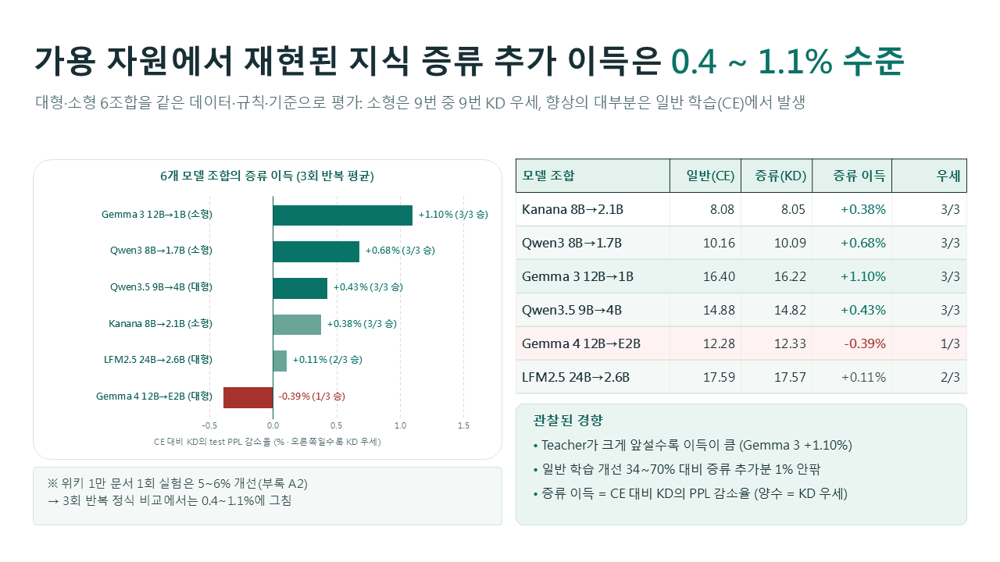
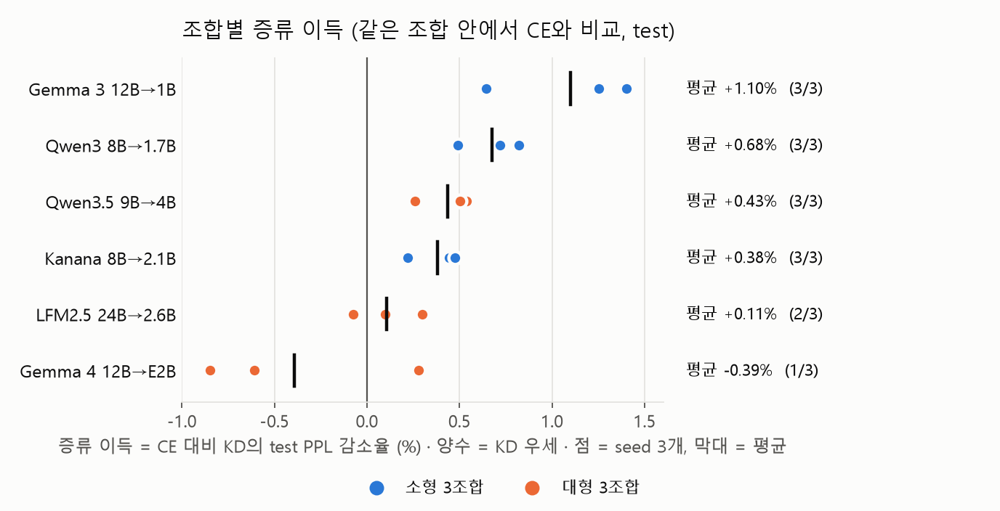
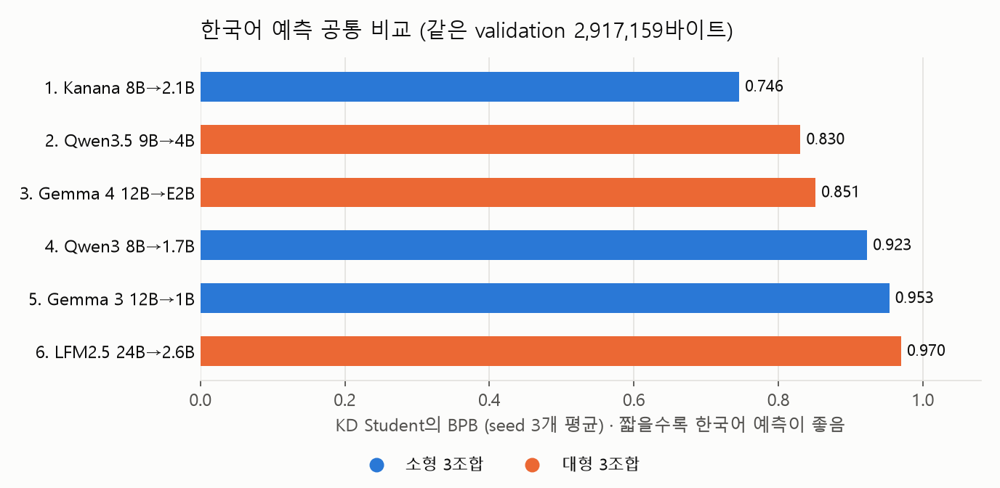
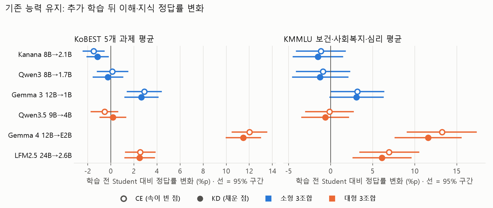
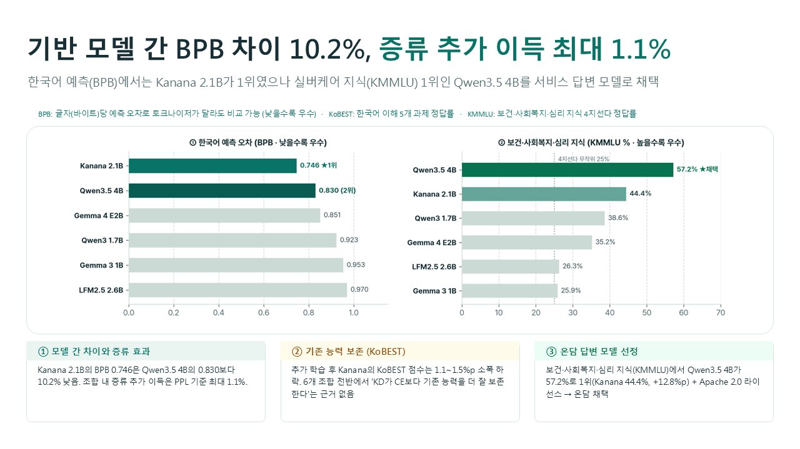

# 지식 증류(KD) 6개 조합 비교 평가 요약

최종 발표 자료의 근거 문서입니다. 대형 3조합과 소형 3조합을 **같은 데이터, 같은 규칙, 같은 기준**으로 평가한 결과를 정리했습니다. 평가 결과를 바탕으로 서비스 구현을 **기반 모델 + RAG**로 선회한 이유도 함께 담았습니다.

발표 파일은 `261203_프로젝트_최종발표_ver3.0(GPT)_길량 수정.pptx`이며, 이 문서와 같은 내용을 7장으로 담았습니다(원본 ver3.0의 5~13쪽 수정본).

**표기 기준**
- **증류 이득** = CE 대비 KD의 test PPL 감소율(%). **양수면 KD가 우세**합니다. 이 문서와 발표 자료 전체에 같은 부호를 씁니다.
- **Teacher** = 지식을 전달하는 큰 모델, **Student** = 지식을 받는 작은 모델.
- **CE** = 정답만 보고 학습(일반 학습), **KD** = 정답과 Teacher의 예측을 함께 보고 학습(지식 증류).

## 핵심 결론

- **현재 조건에서 증류 추가 이득은 0.4~1.1%였습니다.** 소형 3조합은 9번 중 9번 KD가 우세했고, 대형 3조합은 Qwen3.5만 일관됐습니다.
- **Teacher 우위가 클수록 이득이 컸습니다.** Gemma 3(+1.10%)가 가장 컸고, Teacher가 Student보다 뒤처진 LFM2.5는 이득이 거의 없었습니다. 증류가 효과를 내는 조건을 정량으로 확인한 결과입니다.
- **기반 모델 선택의 영향이 더 컸습니다.** 한국어 예측 1위(Kanana 2.1B)와 2위(Qwen3.5 4B)의 BPB 차이는 10.2%로, 증류 이득의 약 10배입니다.
- **서비스는 가장 현실적인 경로로 선회했습니다.** 2026-11-14에 "기반 모델 + 공식 자료 검색(RAG) + 응급 고정 경로 + 자동 안전 검증" 구조로 계획을 바꿨습니다.

## 1. 같은 데이터, 같은 규칙, 같은 기준

| 항목 | 내용 |
|---|---|
| 같은 데이터 | FineWeb2 한국어 train 6,814 / validation 851 / test 851 문서. 6조합 모두 같은 파일(SHA-256 일치) |
| 같은 규칙 | LoRA, 512토큰, 최대 3,000 update, 후보 탐색 2라운드(CE 4·KD 4), seed 42·43·44 설정은 Validation으로만 선택, Test는 모델마다 1회만 채점 |
| 같은 기준 | 공통 지표 3종(BPB, KoBEST, KMMLU)을 42개 모델에 같은 서버, 같은 코드로 채점 대형 조합 체크포인트는 복원 후 기록과 대조(CE 차이 0.000034) |
| 다른 점 | 학습 GPU(3090 / A100). 환경 차이 자체는 측정하지 않음 |

**공통 지표 3종**
- **BPB (bits per byte):** 글자(바이트)당 예측 오차입니다. 모델마다 토크나이저가 달라 PPL을 직접 비교할 수 없으므로, 6개 모델이 같은 2,917,159바이트를 예측하게 해서 비교했습니다. 낮을수록 좋습니다.
- **KoBEST:** 한국어 이해 5개 과제(BoolQ, COPA, HellaSwag, SentiNeg, WiC)의 정답률입니다. 추가 학습 뒤 기존 능력이 유지되는지 봤습니다.
- **KMMLU:** 한국어 전문 지식 4지선다 시험입니다. 돌봄 서비스와 관련된 보건, 사회복지, 심리 3개 과목만 썼습니다.

## 2. 비교 결과

### 종합표

| 모델 조합 | 구분 | 증류 이득 (test) | KD 우세 seed | 한국어 예측 BPB | 이해 KoBEST (KD−CE) | 지식 KMMLU (KD−CE) | 요약 |
|---|---|---|---|---|---|---|---|
| Gemma 3 12B→1B | 소형 | **+1.10%** | 3/3 | 0.953 (5위) | 51.8% (−0.2) | 25.9% (−0.1) | 증류 이득 최대 |
| Qwen3 8B→1.7B | 소형 | +0.68% | 3/3 | 0.923 (4위) | 52.4% (−0.4) | 38.6% (−0.4) | KD 일관, 이득 작음 |
| Qwen3.5 9B→4B | 대형 | +0.43% | 3/3 | **0.830 (2위)** | 64.6% (+0.7) | **57.2% (1위)** | 지식 1위, 서비스 경량판 채택 |
| Kanana 1.5 8B→2.1B | 소형 | +0.38% | 3/3 | **0.746 (1위)** | 67.9% (+0.3) | 44.4% (−0.4) | 한국어 예측 1위 |
| LFM2.5 24B→2.6B | 대형 | +0.11% | 2/3 | 0.970 (6위) | 54.8% (0.0) | 26.3% (−0.8) | 효과 불명확 |
| Gemma 4 12B→E2B | 대형 | −0.39% | 1/3 | 0.851 (3위) | 59.7% (−0.5) | 35.2% (−1.6) | KD가 오히려 불리 |

- **증류 이득:** seed 3개 평균. 양수면 KD가 우세합니다.
- **KoBEST·KMMLU:** KD 모델의 정답률과, 괄호 안은 CE 대비 차이(%p)입니다. 양수면 KD가 높습니다.

### 증류 이득

소형 3조합은 seed 9개 모두에서 KD가 앞섰고, 대형 3조합은 Qwen3.5만 일관됐습니다. 크기는 모두 1% 안팎입니다. 같은 기간에 일반 학습(CE) 자체로 얻은 개선은 34~70%로, 향상의 대부분은 일반 학습에서 나왔습니다.

### Teacher 우위와 증류 이득

Teacher가 Student보다 크게 앞선 조합일수록 이득이 컸습니다(순위 상관 약 0.94). 관측값이 6개이므로 경향으로만 해석합니다. Student보다 확실히 우수한 Teacher와 더 큰 학습에서는 더 큰 이득을 기대할 수 있지만, 그 조건은 이번 가용 자원의 범위를 넘습니다.

### 한국어 예측 (공통 BPB)

15개 쌍 비교가 모두 사전에 정한 마진 1%를 넘어 순위가 겹치지 않았습니다. Kanana는 Qwen3.5보다 BPB가 10.2% 낮습니다(95% 구간 9.4~11.0%).

### 기존 능력 유지 (KoBEST, KMMLU)

KD와 CE를 비교한 12건 중 KD 향상 1건, 하락 3건, 불명확 8건입니다. 증류가 이해·지식 능력을 더 잘 보존한다는 근거는 없었습니다. Kanana는 추가 학습 뒤 KoBEST가 1.1~1.5%p 소폭 내려갔습니다.

### 서비스 답변 모델 선정

한국어 예측은 Kanana 2.1B가 1위였지만, 돌봄 서비스와 직접 관련된 보건·사회복지·심리 지식(KMMLU)에서는 Qwen3.5 4B가 57.2%로 1위였습니다(Kanana 44.4%, +12.8%p). 라이선스(Apache 2.0)까지 고려해 경량판 답변 모델로 Qwen3.5 4B를 채택했습니다.

## 3. 기반 모델 + RAG로 선회한 세 가지 근거

증류가 효과를 내는 조건은 정량으로 확인했습니다. 서비스는 현재 자원과 데이터로 바로 구현할 수 있는 경로를 택했습니다.

| 근거 | 측정된 사실 | 판단 |
|---|---|---|
| **① GPU 센터는 상시 서비스 환경이 아님** | 교내망 전용: 학교 VPN을 거쳐야만 접속되는 연구용 환경 24시간마다 자동 정지, 재시작마다 접속 주소 변경 상시 서비스에 필요한 관리 기능·권한 없음 | 어르신 기기에서 직접 접속할 수 있도록 클라우드에 배포 |
| **② 현재 조건에서는 증류 이득이 작음** | Qwen3.5 증류 이득 +0.43% (일반 한국어, 3회 반복 평균) Teacher+Student 동시 적재 약 27GB(추정) → GPU 2장 분할·LoRA로 학습 규모 제한 돌봄 대화 12건에서는 정답 학습 대비 −0.12% Teacher 우위가 클수록 이득 증가(Gemma 3 +1.10%) | 지금 단계에서는 기반 모델에 RAG를 연결하는 편이 현실적 |
| **③ 증류할 도메인 데이터·Teacher 부족** | 의료 전문가가 검수한 학습 데이터 0건 돌봄 대화 52건뿐, AI Hub 일부 접근 오류 PPL이 크게 줄어도 Teacher 답변 수용은 3/11건 KLUE taskQA: Teacher 우위 2.6%p < 기준 5%p | 의료 지식은 학습 대신 공식 자료 검색(RAG)으로 공급 |

GPU 메모리는 **증류의 규모를 제한한 이유**이지 서비스가 불가능했던 이유는 아닙니다. 참고로 소형 Student 추론은 약 6GB로 충분히 가능했습니다. 학습 시에는 다음과 같은 제약이 있었습니다:
- 8B Teacher와 1.7B Student를 배치 1로 학습해도 GPU 1장 사용량이 22.6 / 24GB였습니다.
- 12B Teacher(24.4GB)는 1장에 올릴 수 없어 2장에 나눠 실었습니다.

## 4. 서비스 방향

온담은 **기반 모델 + 공식 자료 검색(RAG) + 응급 고정 경로 + 자동 안전 검증**으로 구현했습니다. 두 버전 모두 증류 모델이 아닌 기반 모델을 씁니다.

| 버전 | 답변 모델 | 통과 (온담 / ChatGPT) | 위해 답 (온담 / ChatGPT) |
|---|---|---|---|
| 클라우드 | Azure 클라우드 LLM | 72 / 66 (109문항) | 2 / 2 |
| 경량 최종판 | Qwen3.5-4B + RAG | 36 / 65 (107문항) | 7 / 2 |

**발표에서 예상되는 질문과 답**

- *"2B 모델은 24GB면 충분히 돌지 않나요?"* 맞습니다. 추론은 약 6GB였습니다. 서비스 엔진으로 삼기 어려웠던 이유는 메모리가 아닙니다. GPU 센터가 교내망 전용 연구 환경이라 상시 서비스를 할 수 없었고, 현재 조건의 증류 이득이 서비스 품질을 바꿀 만큼 크지 않았습니다.
- *"그럼 증류는 의미가 없었나요?"* 아닙니다. 증류가 효과를 내는 조건을 정량으로 확인했습니다. Teacher가 Student보다 크게 앞설수록 이득이 커졌고, 검수된 도메인 데이터와 더 큰 학습이 갖춰지면 이득이 커질 여지가 있습니다.

## 5. 한계

- 공통 BPB와 KoBEST·KMMLU는 validation과 공개 벤치마크 기준입니다. 대화 품질과 안전성은 온담 AutoQA에서 따로 평가했습니다.
- seed가 3개라 통계적 유의성은 주장하지 않고, 방향의 일관성을 봤습니다.
- 3090과 A100의 학습 환경 차이는 측정하지 않았습니다.
- Teacher 우위와 증류 이득의 관계는 관측값 6개로 본 경향입니다.

## 자료 위치

| 내용 | 위치 |
|---|---|
| 소형 조합 결과, 공통 채점, 기존 능력 유지 | `feature/fineweb-small-model-kd` 브랜치의 `results/small-model-v1/` |
| 대형 조합 결과 | `feature/azure-h100-kd-tuning` 브랜치의 `results/published/generic-kd-v1/` |
| 사전 고정 규칙과 차이 공개 | `feature/fineweb-small-model-kd` 브랜치의 `docs/small-model-kd-v1/` |
| 돌봄 대화 실험(수용 3/11건) | `feature/azure-h100-kd-tuning` 브랜치의 `docs/published/research-closeout-20261114/SILVERCARE.md` |
| 이 문서의 그림 | `fig*.png`는 위 결과 파일로 다시 그림, `slide_*.png`는 발표 파일에서 내보냄 |
