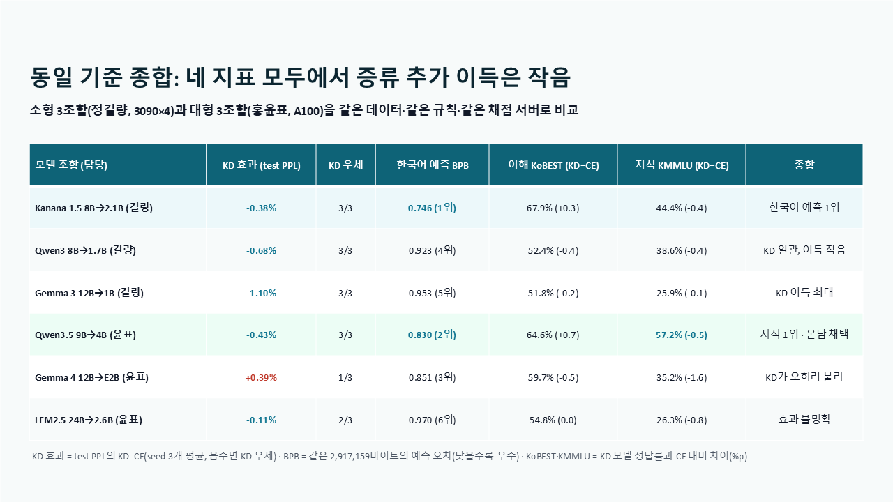
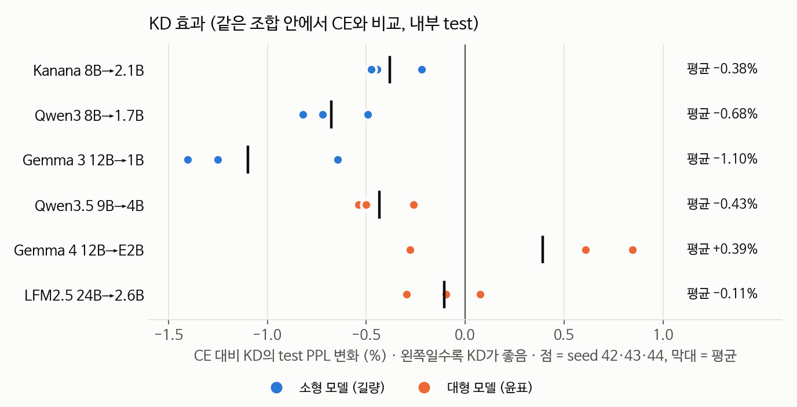
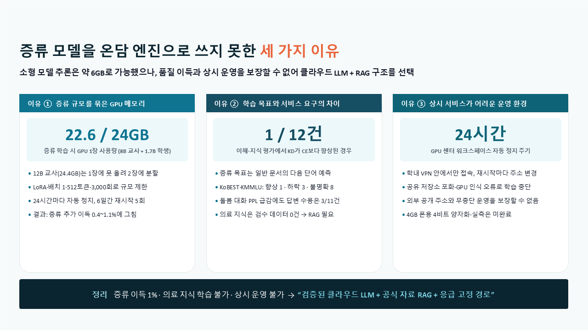

# 지식 증류(KD) 6개 조합 비교 평가 요약

최종 발표용 정리입니다. 소형 3개 조합(정길량, RTX 3090×4)과 대형 3개 조합(홍윤표, A100)을 같은 기준으로 비교한 결과와, 증류 모델을 온담 서비스 엔진으로 쓰지 못한 이유를 담았습니다.

발표 파일 `261203_프로젝트_최종발표_ver3.0(클로드).pptx`, `ver3.0(GPT).pptx`의 10번, 13번 슬라이드가 이 문서의 1절과 3절에 해당합니다. ver2.9는 그대로 두었습니다.

## 핵심 결론

- **증류 추가 이득은 작았습니다.** test PPL 기준 −1.10% ~ +0.39%이고, 이해·지식 평가에서도 KD가 CE보다 낫다는 근거가 없었습니다.
- **기반 모델 선택의 영향이 훨씬 컸습니다.** 한국어 예측 1위(Kanana 2.1B)와 2위(Qwen3.5 4B)의 차이가 10.2%로, 증류 이득의 약 10배입니다.
- **증류 모델은 서비스 엔진으로 쓰지 않았습니다.** 추론은 가능했지만, 품질 이득이 작고 의료 지식을 학습시킬 수 없었으며 GPU 센터에서 상시 운영을 보장할 수 없었습니다.

## 1. 동일 기준 비교

### 같은 기준이라고 말할 수 있는 근거

| 항목 | 내용 |
|---|---|
| 데이터 | FineWeb2 한국어 train 6,814 / validation 851 / test 851 문서. 두 담당자의 파일 SHA-256이 일치 |
| 학습 | LoRA, 512토큰, 최대 3,000 update, 후보 탐색 2라운드(CE 4·KD 4), seed 42·43·44 |
| 선택과 채점 | 설정은 validation으로만 선택, test는 모델마다 1회만 채점 |
| 공통 채점 | 42개 모델을 같은 서버에서 채점. 대형 조합 체크포인트는 복원 후 기록과 대조(CE 차이 0.000034) |
| 다른 점 | 학습 GPU(3090 / A100). 환경 차이 자체는 측정하지 않음 |

### 종합표

| 모델 조합 (담당) | KD 효과 (test PPL) | KD 우세 seed | 한국어 예측 BPB | 이해 KoBEST (KD−CE) | 지식 KMMLU (KD−CE) | 종합 |
|---|---|---|---|---|---|---|
| Kanana 1.5 8B→2.1B (길량) | −0.38% | 3/3 | **0.746 (1위)** | 67.9% (+0.3) | 44.4% (−0.4) | 한국어 예측 1위 |
| Qwen3 8B→1.7B (길량) | −0.68% | 3/3 | 0.923 (4위) | 52.4% (−0.4) | 38.6% (−0.4) | KD 일관, 이득 작음 |
| Gemma 3 12B→1B (길량) | −1.10% | 3/3 | 0.953 (5위) | 51.8% (−0.2) | 25.9% (−0.1) | KD 이득 최대 |
| Qwen3.5 9B→4B (윤표) | −0.43% | 3/3 | **0.830 (2위)** | 64.6% (+0.7) | **57.2%** (−0.5) | 지식 1위, 온담 채택 |
| Gemma 4 12B→E2B (윤표) | +0.39% | 1/3 | 0.851 (3위) | 59.7% (−0.5) | 35.2% (−1.6) | KD가 오히려 불리 |
| LFM2.5 24B→2.6B (윤표) | −0.11% | 2/3 | 0.970 (6위) | 54.8% (0.0) | 26.3% (−0.8) | 효과 불명확 |

- **KD 효과:** test PPL의 KD−CE, seed 3개 평균. 음수면 KD가 우세합니다.
- **BPB:** 6개 토크나이저가 같은 2,917,159바이트를 예측할 때의 오차(validation). 낮을수록 좋습니다.
- **KoBEST·KMMLU:** KD 모델의 정답률과 CE 대비 차이(%p). KMMLU는 보건·사회복지·심리 3개 과목입니다.

### 지표별 결과

**KD 효과 (test).** 소형 3개 조합은 seed 9개 모두에서 KD가 앞섰고, 대형 조합은 Qwen3.5만 일관됐습니다. 크기는 모두 1% 안팎입니다.

**한국어 예측 (공통 BPB).** 15개 쌍 비교가 모두 마진 1%를 넘어 순위가 겹치지 않았습니다. Kanana는 Qwen3.5보다 10.2% 낮습니다(95% 구간 9.4~11.0%).

**기존 능력 유지 (KoBEST, KMMLU).** KD와 CE를 비교한 12건 중 KD 향상 1건, 하락 3건, 불명확 8건입니다. 증류가 이해·지식 능력을 높인다는 근거는 없었습니다.

## 2. 서비스 방향

온담은 **클라우드 LLM + 공식 자료 검색(RAG) + 응급 고정 경로**로 구현했습니다. 경량판(Qwen3.5-4B + RAG)도 함께 시험했으며, 두 버전 모두 증류 모델이 아닌 기반 모델을 씁니다.

| 버전 | 답변 모델 | 통과 (온담 / ChatGPT) | 위해 답 (온담 / ChatGPT) |
|---|---|---|---|
| 클라우드 | Azure 클라우드 LLM | 72 / 66 (109문항) | 2 / 2 |
| 경량 최종판 | Qwen3.5-4B + RAG | 36 / 65 (107문항) | 7 / 2 |

## 3. 증류 모델을 서비스 엔진으로 쓰지 못한 이유

GPU 메모리만으로 설명하면 부족합니다. 소형 Student의 **추론은 약 6GB로 가능**했기 때문입니다. 메모리는 증류의 규모를 제한했고, 그 결과 이득이 작았다는 것이 정확한 설명입니다. 아래 세 가지가 함께 작용했습니다.

| 이유 | 측정된 사실 | 서비스에 주는 의미 |
|---|---|---|
| **① 증류 규모를 묶은 GPU 메모리** | KD 학습 시 GPU 1장 사용량 22.6 / 24GB (8B 교사 + 1.7B 학생, 배치 1) 12B 교사(24.4GB)는 1장에 못 올려 2장에 분할 LoRA·배치 1·512토큰·3,000 update로 제한 24시간마다 자동 정지, 6일간 재시작 5회 | 더 큰 교사, 전체 파라미터 학습, 더 긴 학습을 시도할 수 없어 이득이 0.4~1.1%에 그침 |
| **② 학습 목표와 서비스 요구의 차이** | 증류 목표는 일반 문서의 다음 단어 예측 KoBEST·KMMLU에서 KD 향상 1 · 하락 3 · 불명확 8 돌봄 대화 PPL이 급감해도 답변 수용은 3/11건 의료 전문가 검수 학습 데이터 0건 | PPL이 좋아져도 안전한 답이 되지 않음. 의료 지식은 학습 대신 공식 자료 검색(RAG)으로 공급해야 함 |
| **③ 상시 서비스가 어려운 운영 환경** | 워크스페이스 24시간 자동 정지 학내 VPN 안에서만 접속, 재시작마다 주소 변경 공유 저장소 포화와 GPU 인식 오류로 학습 중단 4GB 폰용 4비트 양자화와 실측 미완료 | 외부 공개 주소와 무중단 운영을 보장할 수 없어 실사용 서비스의 기반으로 쓸 수 없음 |

**발표에서 예상되는 질문과 답**

- *"2B 모델은 24GB면 충분히 돌지 않나요?"* 맞습니다. 추론은 약 6GB였습니다. 막힌 것은 추론이 아니라, 증류 이득이 1%여서 서비스 품질을 바꾸지 못한다는 점과 GPU 센터에서 상시 운영을 할 수 없다는 점입니다.
- *"자원이 더 있었다면 달라졌을까요?"* 교사가 학생보다 크게 앞설수록 이득이 커지는 경향은 보였습니다. 다만 점이 6개뿐이라 경향 수준이며, 더 큰 교사와 더 큰 학습에서의 결과는 측정하지 못했습니다.

## 4. 한계

- 공통 BPB와 KoBEST·KMMLU는 validation과 공개 벤치마크 기준이며, 대화 품질과 안전성은 온담 AutoQA에서 따로 평가했습니다.
- seed가 3개라 통계적 유의성은 주장하지 않고, 방향의 일관성을 봤습니다.
- 3090과 A100의 학습 환경 차이는 측정하지 않았습니다.

## 자료 위치

| 내용 | 위치 |
|---|---|
| 소형 조합 결과, 공통 채점, 기존 능력 유지 | `feature/fineweb-small-model-kd` 브랜치의 `results/small-model-v1/` |
| 대형 조합 결과 | `feature/azure-h100-kd-tuning` 브랜치의 `results/published/generic-kd-v1/` |
| 사전 고정 규칙과 차이 공개 | `feature/fineweb-small-model-kd` 브랜치의 `docs/small-model-kd-v1/` |
| 돌봄 대화 실험(수용 3/11건) | `feature/azure-h100-kd-tuning` 브랜치의 `docs/published/research-closeout-20261114/SILVERCARE.md` |
