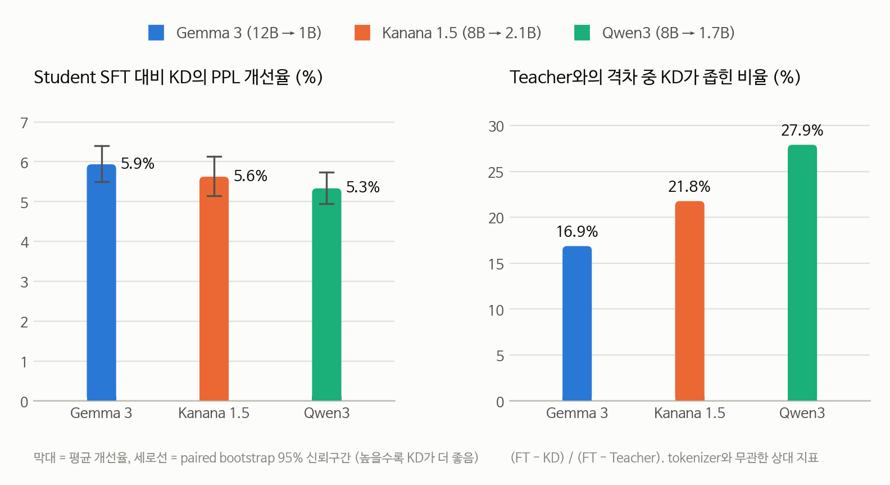
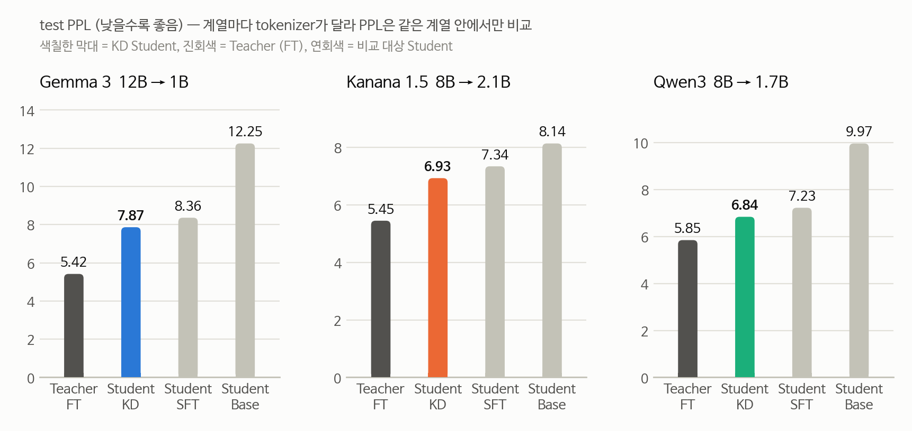
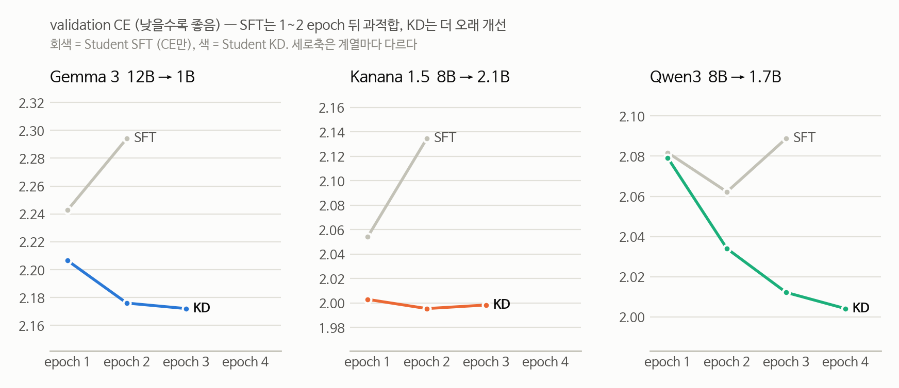
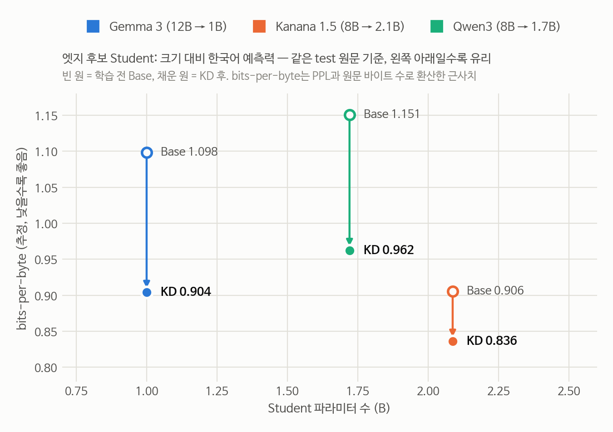

# 한국어 지식증류(KD) 3개 계열 비교 — 중간 점검 보고서

작성일 **2026-10-29** · 브랜치 `feature/qwen3-4way-kd` · 대상: 조원 중간 점검 회의

Gemma 3, Kanana 1.5, Qwen3 세 계열에서 **같은 한국어 위키 1만 문서, 같은 KD 설정**으로 대형 Teacher의 지식을 소형 Student로
증류하고, 4-way(Teacher FT / Student KD / Student SFT / Student Base)로 비교했다. 이 문서는 저장소에 커밋된 결과 파일만으로 만들었고,
차트와 수치는 `scripts/make_kd_report_figures.py`로 다시 만들 수 있다.

---

## 한눈에 보기

| | Gemma 3 12B → 1B | Kanana 1.5 8B → 2.1B | Qwen3 8B → 1.7B |
|---|---:|---:|---:|
| **Student SFT 대비 KD 개선** | **−5.9%** | **−5.6%** | **−5.3%** |
| 통계 판정 (paired bootstrap 95% CI) | 유의 | 유의 | 유의 |
| Teacher와의 격차 중 KD가 좁힌 비율 | 16.9% | 21.8% | **27.9%** |
| KD Student 한국어 bits-per-byte (추정, 낮을수록 좋음) | 0.904 | **0.836** | 0.962 |
| Student 크기 / 4비트 양자화 시 메모리 (추정) | **1.0B / 약 0.6GB** | 2.1B / 약 1.2GB | 1.7B / 약 1.0GB |

1. **세 계열 모두에서 KD가 일반 미세조정(SFT)을 약 5~6% 앞섰고, 셋 다 통계적으로 유의하다.** 다국어 범용(Gemma, Qwen3)과
   한국어 특화(Kanana) 모델에서 결론이 같다.
2. **KD는 과적합을 막는 방식으로 이득을 낸다.** SFT는 1~2 epoch 뒤 바로 나빠지지만 KD는 더 오래 개선된다.
   데이터가 적은 실버케어 분야에서 특히 유리할 수 있다.
3. **실버케어 엣지 모델 1순위 후보는 Kanana 1.5 (8B → 2.1B), 초경량 기기 대안은 Gemma 3 (12B → 1B)** 이다. 근거는 [4장](#4-실버케어-엣지-모델-제안).
4. 다음 단계는 **어르신 대화·건강 점검 도메인 데이터로 같은 파이프라인을 다시 돌리고, 안전성과 사용성까지 평가하는 것**이다 ([5장](#5-다음-계획-실버케어용-데이터셋과-평가)).

---

## 1. 실험 조건

세 계열을 같은 프로토콜(v4)로 돌렸다. 다른 곳은 모델별 입력 형식과 메모리 제약에서 생긴 차이뿐이다.

| 항목 | 값 (세 계열 공통) |
|---|---|
| 데이터 | 한국어 위키 `wikimedia/wikipedia 20231101.ko` (revision 고정) 10,000문서, 문서 단위 split 90/5/5 (seed 42) |
| 시퀀스 길이 / 배치 | 256 / GPU당 1, 전체 2 |
| Teacher 미세조정 | QLoRA (nf4), LoRA r16, 3 epoch, lr 2e-5 |
| KD | Base 초기값 + forward KL, T = 2, α = 0.5, top-K 128, lr 1e-5, Adafactor |
| Student 학습 | 최대 4 epoch, early stopping (patience 1, min_delta 0.005), best는 val CE 기준 |
| 평가 | test 500문서. PPL, paired bootstrap (10,000회 복원추출) |
| 장비 | RTX 3090 24GB × 4 (VESSL) |

| 계열별 차이 | Gemma 3 | Kanana 1.5 | Qwen3 |
|---|---|---|---|
| KD에 쓴 Teacher 정밀도 | **int8** (12B가 24GB에 안 들어감) | bf16 | bf16 |
| 청크 BOS | 붙임 (Gemma는 BOS 필수) | 붙이지 않음 (붙이면 PPL 악화) | 없음 (tokenizer에 BOS 없음) |
| test 청크 / 예측 토큰 수 | 832 / 212,160 | 820 / 209,100 | 950 / 242,250 |

> **PPL은 같은 계열 안에서만 비교한다.** tokenizer가 다르면 같은 문장도 토큰 수가 달라 PPL 절대값의 의미가 다르다.
> 계열 간 비교는 상대 지표(개선율, 격차 중 KD가 좁힌 비율)와 bits-per-byte로 한다.

---

## 2. 결과

### 2.1 KD 효과 — 세 계열 모두 유의한 개선

<picture>
  <source media="(prefers-color-scheme: dark)" srcset="figures/kd-midterm/kd-gain-dark.png">
  
</picture>

| 계열 | FT → KD 개선 | 95% CI (개선율) | KD가 더 나은 test 청크 | 격차 중 KD가 좁힌 비율 |
|---|---:|---:|---:|---:|
| Gemma 3 12B → 1B | −5.9% | [−6.4%, −5.5%] | 724 / 832 (87.0%) | 16.9% |
| Kanana 1.5 8B → 2.1B | −5.6% | [−6.1%, −5.1%] | 668 / 820 (81.5%) | 21.8% |
| Qwen3 8B → 1.7B | −5.3% | [−5.7%, −5.0%] | 841 / 950 (88.5%) | 27.9% |

- 세 신뢰구간 모두 0에서 멀리 떨어져 있다. **KD 이득은 노이즈가 아니다.**
- 개선율은 셋이 비슷하지만(5.3~5.9%), **Teacher와의 격차를 얼마나 메웠는지는 Qwen3가 가장 크다**(27.9%).
  Qwen3는 KD가 4 epoch 상한까지 계속 개선 중이었다(2.3절).

### 2.2 4-way PPL — 계열별

<picture>
  <source media="(prefers-color-scheme: dark)" srcset="figures/kd-midterm/four-way-ppl-dark.png">
  
</picture>

| 계열 | Teacher (FT) | **Student (KD)** | Student (SFT) | Student (Base) | Base → SFT |
|---|---:|---:|---:|---:|---:|
| Gemma 3 12B → 1B | 5.418 | **7.866** | 8.363 | 12.253 | −31.8% |
| Kanana 1.5 8B → 2.1B | 5.449 | **6.929** | 7.341 | 8.136 | −9.8% |
| Qwen3 8B → 1.7B | 5.847 | **6.841** | 7.225 | 9.966 | −27.5% |

- 세 계열 모두 `Teacher < KD < SFT < Base` 순서가 나왔다.
- **Kanana는 Base가 이미 한국어에 강해서 SFT로 얻는 몫이 작다**(−9.8%). 대신 KD 몫(격차 중 21.8%)은 Gemma보다 크다.

### 2.3 학습 곡선 — SFT는 과적합, KD는 계속 개선

<picture>
  <source media="(prefers-color-scheme: dark)" srcset="figures/kd-midterm/val-ce-curves-dark.png">
  
</picture>

| validation CE | epoch 1 | epoch 2 | epoch 3 | epoch 4 | best |
|---|---:|---:|---:|---:|---|
| Gemma 3 — SFT | **2.2428** | 2.2942 | | | epoch 1 |
| Gemma 3 — KD | 2.2065 | **2.1761** | 2.1721 | | epoch 2 ¹ |
| Kanana 1.5 — SFT | **2.0541** | 2.1345 | | | epoch 1 |
| Kanana 1.5 — KD | 2.0029 | **1.9954** | 1.9984 | | epoch 2 |
| Qwen3 — SFT | 2.0818 | **2.0622** | 2.0888 | | epoch 2 |
| Qwen3 — KD | 2.0792 | 2.0340 | 2.0121 | **2.0041** | epoch 4 (상한) |

¹ epoch 3이 조금 더 낮지만 개선폭(0.004)이 min_delta 0.005보다 작아 best로 저장되지 않았다.

- **SFT는 세 계열 모두 1~2 epoch 뒤 val CE가 다시 올라간다** (train 데이터를 외우기 시작).
- **KD는 같은 시점에 계속 내려간다.** Teacher의 확률 분포가 정답 단어 하나만 보는 학습을 정규화해서, 같은 데이터를 더 오래
  유효하게 학습한다. KD 이득이 "더 오래 학습해서"가 아니라는 근거다(같은 epoch에서 SFT는 나빠졌다).
- **Qwen3 KD는 4 epoch 상한에서 아직 개선 중**이었다. 상한을 늘리면 추가 이득이 있을 수 있다.

### 2.4 데이터 규모의 효과 (1,000문서 → 10,000문서)

| 실험 | 데이터 | KD 설정 | FT → KD | 격차 중 KD 몫 | 통계 판정 |
|---|---|---|---:|---:|---|
| Gemma v3 | 1,000문서 | SFT 초기값 + reverse KL | −0.17% | 0.4% | 유의하지 않음 |
| Gemma v3 요인 분리 | 1,000문서 | Base 초기값 + forward KL | −1.77% | 4.3% | 유의 |
| **Gemma v4** | **10,000문서** | Base 초기값 + forward KL | **−5.9%** | **16.9%** | 유의 |
| Qwen2.5 v3 (7B → 1.5B) | 1,000문서 | SFT 초기값 + reverse KL | −1.09% | 3.1% | 검정 안 함 |
| Qwen2.5 H100 튜닝 (α 0.7) | 1,000문서 | SFT 초기값 + reverse KL | −3.9% | 11.1% | 검정 안 함 |

- 같은 KD 설정에서 데이터를 10배로 늘리자 **격차 중 KD 몫이 4.3% → 16.9%로 약 4배** 커졌다.
- 1,000문서에서는 **SFT 체크포인트에서 KD를 시작하면 이득이 사라졌다.** v4는 그래서 Base 초기값으로 바꿨다.

### 2.5 계열 간 절대 비교 — bits-per-byte

<picture>
  <source media="(prefers-color-scheme: dark)" srcset="figures/kd-midterm/edge-tradeoff-dark.png">
  
</picture>

bits-per-byte(BPB)는 원문 UTF-8 1바이트를 예측하는 데 필요한 평균 비트 수다. tokenizer와 무관해서 **계열끼리 절대 성능을 비교할 수 있다.**

| 모델 | Teacher (FT) | Student (KD) | Student (SFT) | Student (Base) | 원문 바이트/토큰 |
|---|---:|---:|---:|---:|---:|
| Gemma 3 12B → 1B | 0.741 | 0.904 | 0.931 | 1.098 | 3.29 |
| Kanana 1.5 8B → 2.1B | **0.732** | **0.836** | 0.861 | 0.906 | **3.34** |
| Qwen3 8B → 1.7B | 0.884 | 0.962 | 0.990 | 1.151 | 2.88 |

- **추정치다.** 세 계열의 test는 같은 500개 문서이므로, 각 계열의 test 손실 합을 같은 원문 바이트 수(698,305, Qwen 실측)로 나눴다.
  청크 첫 토큰과 꼬리 자투리만큼 바이트가 조금 달라 생기는 오차는 1% 미만으로 본다. Qwen3의 추정값(Base 1.1507, Teacher 0.8839)은
  `scripts/eval_bpb.py` 실측값(1.1508, 0.8839)과 일치한다.
- **한국어 예측력은 Kanana > Gemma > Qwen3 순이다.** Kanana는 학습 전 Base(0.906)가 이미 Gemma KD 결과(0.904) 수준이다.
- **원문 바이트/토큰**이 클수록 같은 한국어 문장을 적은 토큰으로 만든다. Qwen3는 Kanana보다 같은 문장에 약 16% 많은 토큰이 필요해,
  같은 기기에서 같은 속도로 생성해도 응답이 그만큼 늦다.

### 2.6 참고: Qwen 세대 비교 (Qwen2.5 vs Qwen3)

두 세대는 test를 토큰 단위까지 똑같이 자르므로(`scripts/eval_bpb.py`로 확인) PPL을 직접 비교할 수 있다. 1만 문서 test, 학습 전 Base 모델.

| 크기대 | Qwen2.5 | Qwen3 | 차이 |
|---|---:|---:|---:|
| Student급 (1.5B / 1.7B) | 10.660 (BPB 1.184) | 9.968 (BPB 1.151) | −6.5% |
| Teacher급 (7B / 8B) | 7.731 (BPB 1.024) | 6.990 (BPB 0.973) | −9.6% |

---

## 3. 결과 해석 요약

| 질문 | 답 | 근거 |
|---|---|---|
| KD가 SFT보다 나은가? | **예, 세 계열 모두** | FT → KD −5.3 ~ −5.9%, bootstrap 95% CI 모두 0 미포함 |
| 효과가 모델 계열에 따라 달라지는가? | 개선율은 비슷, 격차를 메우는 정도는 다름 | 격차 중 KD 몫 16.9% / 21.8% / 27.9% |
| 왜 이득이 나는가? | 과적합 억제 | SFT는 1~2 epoch 뒤 악화, KD는 계속 개선 |
| 무엇이 이득을 키우는가? | 데이터 규모, Base 초기값 | 1천 → 1만 문서에서 격차 중 KD 몫 4배, SFT 초기값 KD는 이득 없음 |
| 한국어 절대 성능은? | Kanana > Gemma > Qwen3 | bits-per-byte (추정) 0.836 / 0.904 / 0.962 |

---

## 4. 실버케어 엣지 모델 제안

### 4.1 판단 기준

엣지 기기(태블릿, 스마트 디스플레이, 돌봄 로봇·홈 허브 등)에서 어르신과 한국어로 대화하는 모델이라는 전제로 아래 순서로 본다.

| 기준 | Gemma 3 12B → 1B | Kanana 1.5 8B → 2.1B | Qwen3 8B → 1.7B |
|---|---|---|---|
| ① 한국어 품질 (KD Student BPB, 추정) | ○ 0.904 | ◎ **0.836** | △ 0.962 |
| ② KD 효과 (같은 조건) | ◎ −5.9%, 유의 | ◎ −5.6%, 유의 | ◎ −5.3%, 유의 |
| ③ 크기·메모리 (4비트 추정) | ◎ **1.0B, 약 0.6GB** | ○ 2.1B, 약 1.2GB | ○ 1.7B, 약 1.0GB |
| ④ 한국어 토큰 효율 (바이트/토큰) | ◎ 3.29 | ◎ **3.34** | △ 2.88 |
| ⑤ Teacher 학습 비용 (3090 기준) | △ 12B, int8 필요 | ◎ 8B bf16 | ◎ 8B bf16 |
| ⑥ 라이선스 ² | ○ Gemma 이용약관 (사용 제한 정책) | ◎ Apache-2.0 | ◎ Apache-2.0 |
| ⑦ 대화형(instruct) 공개 모델 | 있음 (1B-it) | 있음 (1.5 instruct) | 있음 (thinking 모드 지원) |

² 배포 전에 최신 라이선스 원문을 다시 확인해야 한다.

### 4.2 제안

**1순위: Kanana 1.5 (8B → 2.1B)**
- **어르신과 대화할 한국어 품질이 가장 좋다.** KD Student의 BPB가 0.836으로 다른 두 계열보다 7~13% 낮다.
- 한국어 특화 모델이라 존댓말, 일상 어휘, 짧은 문장 같은 실버케어 대화 특성에 유리할 가능성이 크다.
- 토큰 효율이 가장 좋아 같은 기기에서 응답이 빠르다. Apache-2.0으로 상용 배포 부담이 적다.
- Teacher가 8B라 3090에서도 양자화 없이 KD를 돌릴 수 있어, 도메인 데이터로 반복 실험하기 쉽다.
- 대상 기기: 메모리 4GB 이상(4비트 양자화 시 모델 약 1.2GB + 대화 캐시)인 태블릿·스마트 디스플레이·홈 허브.

**대안: Gemma 3 (12B → 1B) — 초경량 기기용**
- Kanana의 절반 크기로 한국어 품질 2위다. Qwen3 1.7B보다 작은데도 BPB가 낮다(0.904 vs 0.962).
- 저사양 스마트폰, 웨어러블과 연동하는 소형 허브처럼 메모리가 빠듯한 기기에 맞다.
- 단점: 12B Teacher가 무거워 KD 때 int8로 줄여야 했고, BOS 처리에 민감하며, 이용약관의 사용 제한 정책을 따라야 한다.

**Qwen3 (8B → 1.7B) — 비교 기준으로 유지**
- 한국어 절대 품질과 토큰 효율이 가장 낮아 지금 근거로는 1순위로 권하지 않는다.
- 다만 KD로 격차를 가장 많이 메웠고(27.9%) 4 epoch에도 계속 개선 중이었다. 데이터와 epoch을 늘리면 차이가 줄어들 수 있다.
- 다국어 응대(외국인 돌봄 인력, 다문화 가정)나 도구 호출(복약 알림, 일정 등록)이 중요해지면 다시 검토할 가치가 있다.

**구성 제안: 엣지 + 서버 분담**
- 일상 대화, 복약·일정 알림, 위험 신호 1차 감지는 **엣지 Student**가 맡는다(오프라인에서도 동작, 개인정보가 기기 밖으로 덜 나감).
- 복잡한 건강 질문이나 위험 상황은 **서버의 Teacher(8B)와 사람(보호자·돌봄 인력·의료진)에게 넘긴다.**
  Kanana 8B Teacher (FT)의 BPB는 0.732로 이번 실험의 모든 모델 중 가장 낮다.

> **주의:** 위 순위는 **위키 문장 예측력** 기준이다. 대화 품질, 안전성, 실제 기기 속도는 아직 재지 않았다.
> 최종 선정은 5장의 도메인 평가와 기기 실측 뒤에 한다. 1순위와 대안 두 계열로 다음 단계를 진행하는 것을 권한다.

---

## 5. 다음 계획: 실버케어용 데이터셋과 평가

### 5.1 목표 기능과 필요한 데이터

| 목표 기능 | 필요한 능력 | 데이터 후보 | 출처 | 용도 |
|---|---|---|---|---|
| 어르신 대화 이해 | 노년층 구어체, 사투리, 느리고 반복되는 발화 | 자유대화 음성(노인남여) 전사문 | AI Hub | KD 학습 · 도메인 평가 |
| | | 한국어 방언 발화 (경상·전라·제주·충청·강원) | AI Hub | 학습 · 평가 |
| | | 주제별 텍스트 일상 대화 | AI Hub | 학습 |
| 정서 돌봄 | 공감 응답, 외로움·우울 신호 인지 | 감성 대화 말뭉치 | AI Hub | 학습 · 평가 |
| | | 웰니스 대화 스크립트 | AI Hub | 학습 · 평가 |
| 건강 특이사항 점검 | 증상 질문 이해, 위험 신호 판단 | 헬스케어 질의응답 데이터 (명칭·공개 범위 확인 필요) | AI Hub | 학습 · 평가 |
| | | **위험 상황 시나리오 세트** (낙상, 흉통, 호흡곤란, 뇌졸중 징후, 저혈당, 자해 위험, 치매 의심, 복약 혼동) | **자체 제작**: Teacher로 초안 생성 → 의료·돌봄 전문가 검수 | **안전 평가의 핵심** · 학습 |
| 복약 안내 | 쉬운 말 설명, 출처 표시 | 의약품개요정보(e약은요) API | 식약처 · 공공데이터포털 | 검색 증강(RAG) 근거 문서 |
| | | 국가건강정보포털 | 질병관리청 | RAG 근거 (이용 조건 확인 필요) |
| 기본 지식·안전 점검 | 의료 지식, 한국어 이해, 편향·민감 질문 | KorMedMCQA (의사·간호사·약사 국가시험) | Hugging Face | 평가 |
| | | KMMLU, KoBEST | Hugging Face | 평가 |
| | | KoSBi, SQuARe (편향·민감 질문) | NAVER AI | 평가 |

- AI Hub 데이터는 이용 약관(연구 목적, 반출 제한 등)이 있어 **신청 전에 조건을 확인**해야 한다.
- 실제 환자 정보는 쓰지 않는다. 시나리오는 비식별 또는 합성으로 만든다.

### 5.2 단계별 계획

| 단계 | 내용 | 산출물 / 평가 지표 |
|---|---|---|
| **1. 도메인 적응 KD** | 지금 파이프라인(v4)을 그대로 쓰고 데이터만 어르신 대화·정서 돌봄 텍스트로 바꾼다. 1순위(Kanana)와 대안(Gemma) 두 계열 | 도메인 test PPL·BPB, KD vs SFT bootstrap, 위키 test로 기존 능력 유지 확인 |
| **2. 응답 KD (instruct)** | instruct Teacher로 어르신 대화·건강 점검 시나리오 응답을 만들고 전문가가 검수한 뒤, Student에 응답 증류 + logit KD | 응답 품질 자동 평가, 시나리오 정답률 |
| **3. 안전·사용성 평가** | 위험 상황 시나리오, 의료 한계(진단·처방 단정 금지), 반복 질문 일관성 | **위험 상황 놓침률(최우선)**, 근거 없는 의료 조언 비율, 응답·문장 길이, 존댓말 비율, 어려운 단어 비율, 어르신·돌봄 인력 블라인드 평가 |
| **4. 엣지 실측** | 4비트 양자화(GGUF 등) 후 실제 기기에서 측정. 음성 입출력(STT/TTS) 포함 | 양자화 전후 품질 하락폭, 첫 토큰 지연, 초당 토큰, 메모리, 발열·배터리 |

- 실버케어에서는 평균 점수보다 **위험 상황을 놓치지 않는 것**이 우선이다. 놓침률 목표치를 팀에서 먼저 합의하길 권한다.
- 2.3절의 결과처럼 KD는 데이터가 적을 때 과적합을 막아 준다. 실버케어 도메인 데이터는 위키보다 훨씬 적을 것이라 **KD를 유지하는 것이 유리하다.**

---

## 6. 그 밖의 특이사항과 제안

### 6.1 실험 신뢰도
- **seed가 하나다.** bootstrap은 test 문서 구성의 흔들림만 잡는다. 결론을 굳히려면 최소 한 계열(1순위 Kanana 권장)은 seed 3개로 반복해야 한다.
- **Qwen3 KD는 epoch 상한(4)에 걸려 멈췄다.** 공정 비교를 위해 같은 상한을 썼지만, 상한을 늘린 별도 실험으로 남은 이득을 확인할 가치가 있다.
- **처리 속도(tokens/s)는 계열 간 비교하지 않는다.** Gemma는 attention 구현(eager)과 평가 배치가 달라 숫자가 직접 비교되지 않는다. 엣지 속도는 5.2의 기기 실측으로 판단한다.
- 실험 자동 요약(`notes.md`)은 KD < SFT이면 무조건 "증류 효과 확인됨"으로 적는다. **판정 근거는 bootstrap만 쓴다.**

---

## 부록

### 재현 방법

```bash
# 한 계열의 v4 실험 (tmux 안에서, 재시작 후에도 같은 명령으로 이어감)
tmux new -d -s run "bash scripts/run_v4_session.sh configs/qwen3_8b_1.7b_3090x4_v4.yaml 'Qwen3 v4' 'Qwen3 8B -> 1.7B'; exec bash"

# PPL / bits-per-byte 측정 (여러 모델, 같은 test 원문)
CUDA_VISIBLE_DEVICES=0 PYTHONPATH=. .venv-gemma/bin/python scripts/eval_bpb.py configs/qwen3_8b_1.7b_3090x4_v4.yaml \
  --out results/qwen3/logs/qwen-family-bpb/bpb.json --model "Qwen3-1.7B Base=Qwen/Qwen3-1.7B-Base"

# 이 보고서의 차트와 summary.json
python3 scripts/make_kd_report_figures.py
```

### 수치 출처

| 내용 | 파일 |
|---|---|
| 4-way PPL | `results/{gemma3,kanana,qwen3}/logs/<run>/evaluation_results.json` |
| bootstrap | `results/.../paired_bootstrap.json` |
| 학습 곡선 | `results/.../{teacher,baseline,distill}_history.json` |
| Qwen 계열 BPB 실측 | `results/qwen3/logs/qwen-family-bpb/bpb.json` |
| 이 보고서의 계산값 | `docs/figures/kd-midterm/summary.json` |
| 계열별 상세 문서 | [Gemma v4](gemma3-v4.md) · [Gemma v3 요인 분리](gemma3-v3-ablation.md) · [3개 계열 진행 현황](kd-3family-status.md) |
