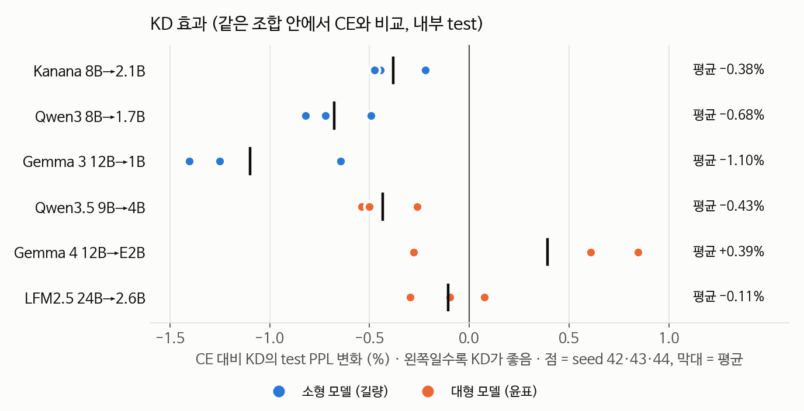
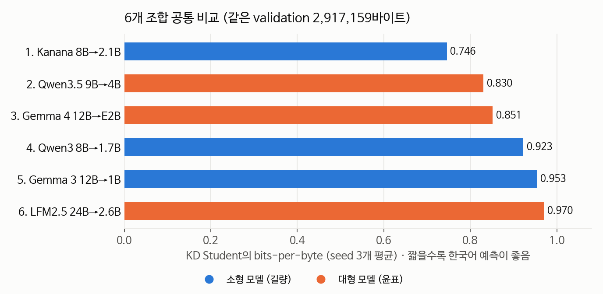
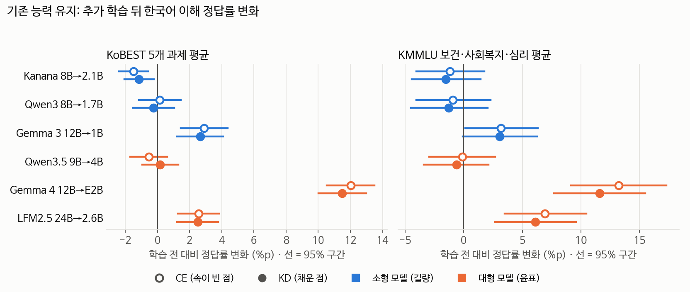

# 6개 조합 KD 검증 결과

소형 모델 3개 조합(길량)과 대형 모델 3개 조합(윤표)을 같은 데이터, 같은 지표로 비교했습니다.

## 요약

- 소형 3개 조합은 seed 9개 모두에서 KD가 CE보다 test PPL이 낮았습니다. 개선 폭은 0.4~1.1%로 작습니다.
- 대형 조합은 Qwen3.5만 KD가 일관되게 나았고, Gemma 4와 LFM2.5는 seed마다 결과가 달랐습니다.
- 한국어 텍스트 예측은 Kanana 2.1B가 가장 좋았습니다. 2위 Qwen3.5 4B보다 bits-per-byte가 10.2% 낮습니다.
- 모델 크기보다 한국어 학습 여부의 영향이 더 컸습니다.
- 추가 학습 뒤 Kanana는 한국어 이해 점수(KoBEST)가 1%p 남짓 떨어졌고, KD가 원래 능력을 더 잘 지킨다는 근거는 없었습니다. 보건·사회복지·심리 지식 문항(KMMLU)은 Qwen3.5가 가장 높았습니다.

## 평가 조건

| | 소형 모델 (길량) | 대형 모델 (윤표) |
|---|---|---|
| 조합 | Qwen3 8B → 1.7B Gemma 3 12B → 1B Kanana 1.5 8B → 2.1B | Qwen3.5 9B → 4B Gemma 4 12B → E2B LFM2.5 24B → 2.6B |
| GPU | RTX 3090 × 4 | A100 |
| 데이터 | FineWeb2 한국어 train 6,814 / validation 851 / test 851 문서 | 같음 |
| 학습 | LoRA, seq 512, 최대 3,000 update, 후보 2라운드, seed 42·43·44 | 같음 |

설정은 validation으로만 골랐고 test는 한 번만 채점했습니다.

| 소형 조합 (길량) | CE | KD |
|---|---|---|
| Qwen3 | LR 1.5e-4 | LR 1.5e-4, alpha 0.7 |
| Kanana | LR 7.5e-5 | LR 1e-4, alpha 0.7 |
| Gemma 3 | LR 1.5e-4 | LR 1.5e-4, alpha 0.7 |

## 1. KD 효과 (test)

| 조합 | Teacher | 학습 전 | CE (seed 42 / 43 / 44) | KD (seed 42 / 43 / 44) | KD − CE | KD 우세 seed |
|---|---|---|---|---|---|---|
| Kanana (길량) | 6.974 | 12.684 | 8.081 / 8.066 / 8.082 | 8.063 / 8.030 / 8.043 | −0.38% | 3/3 |
| Qwen3 (길량) | 7.452 | 15.404 | 10.161 / 10.156 / 10.158 | 10.111 / 10.083 / 10.075 | −0.68% | 3/3 |
| Gemma 3 (길량) | 9.433 | 54.138 | 16.357 / 16.382 / 16.448 | 16.251 / 16.152 / 16.242 | −1.10% | 3/3 |
| Qwen3.5 (윤표) | 12.191 | 19.655 | 14.862 / 14.883 / 14.899 | 14.823 / 14.803 / 14.824 | −0.43% | 3/3 |
| Gemma 4 (윤표) | 11.235 | 4,809 | 12.262 / 12.279 / 12.297 | 12.365 / 12.353 / 12.263 | +0.39% | 1/3 |
| LFM2.5 (윤표) | 19.004 | 54.678 | 17.592 / 17.629 / 17.544 | 17.575 / 17.577 / 17.557 | −0.11% | 2/3 |

값은 test PPL입니다. 토크나이저가 달라 PPL은 같은 조합 안에서만 비교합니다. 성능 향상은 대부분 학습 전 → CE 단계에서 나오고, KD가 더하는 부분은 1% 안팎입니다. Gemma 계열의 학습 전 PPL이 큰 것은 대화용 모델을 BOS 없이 평가했기 때문입니다.

## 2. 6개 조합 비교 (validation bits-per-byte)

6개 토크나이저가 모두 같은 바이트(2,917,159바이트)를 예측하도록 맞춰 채점했습니다. 윤표 모델도 같은 서버에서 체크포인트를 복원해 채점했습니다.

| 순위 | Student | 학습 전 | CE | KD | KD − CE |
|---|---|---|---|---|---|
| 1 | Kanana 2.1B (길량) | 0.879 | 0.747 | 0.746 | −0.15% |
| 2 | Qwen3.5 4B (윤표) | 0.889 | 0.832 | 0.830 | −0.15% |
| 3 | Gemma 4 E2B (윤표) | 2.795 | 0.851 | 0.851 | +0.03% |
| 4 | Qwen3 1.7B (길량) | 1.058 | 0.925 | 0.923 | −0.29% |
| 5 | Gemma 3 1B (길량) | 1.265 | 0.957 | 0.953 | −0.42% |
| 6 | LFM2.5 2.6B (윤표) | 1.429 | 0.970 | 0.970 | −0.06% |

CE·KD는 seed 3개 평균입니다.

| 비교 (KD) | 차이 | 95% 구간 |
|---|---|---|
| Kanana < Qwen3.5 | 10.2% | 9.4 ~ 11.0% |
| Kanana < Gemma 4 | 12.4% | 11.8 ~ 13.0% |
| Qwen3.5 < Gemma 4 | 2.4% | 2.0 ~ 2.9% |
| Qwen3 < Gemma 3 | 3.2% | 2.8 ~ 3.7% |
| Gemma 3 < LFM2.5 | 1.7% | 1.3 ~ 2.1% |

15개 쌍 모두 차이가 1%보다 컸고(0.5% 기준으로 봐도 같음), 순위가 겹치는 경우는 없었습니다.

## 3. 기존 능력 유지 (KoBEST, KMMLU)

한국어 일반 문서로 추가 학습한 뒤에도 원래의 한국어 이해 능력이 유지되는지 봤습니다. 공통 비교와 같은 42개 모델을 KoBEST 5개 과제와 KMMLU 3개 과목(보건, 사회복지, 심리)으로 0-shot 채점했습니다. 규칙은 결과를 보기 전에 [RETENTION_RULE.md](RETENTION_RULE.md)로 고정했습니다.

| Student | 벤치마크 | 학습 전 | CE | KD | CE − 학습 전 | KD − 학습 전 | KD − CE |
|---|---|---|---|---|---|---|---|
| Kanana 2.1B (길량) | KoBEST | 69.1 | 67.6 | 67.9 | **−1.5 하락** | **−1.1 하락** | +0.3 |
| | KMMLU | 45.9 | 44.8 | 44.4 | −1.2 | −1.5 | −0.4 |
| Qwen3 1.7B (길량) | KoBEST | 52.6 | 52.8 | 52.4 | +0.1 | −0.3 | **−0.4 하락** |
| | KMMLU | 39.8 | 38.9 | 38.6 | −0.9 | −1.3 | −0.4 |
| Gemma 3 1B (길량) | KoBEST | 49.2 | 52.1 | 51.8 | **+2.9 향상** | **+2.7 향상** | −0.2 |
| | KMMLU | 22.8 | 26.0 | 25.9 | **+3.2 향상** | +3.1 | −0.1 |
| Qwen3.5 4B (윤표) | KoBEST | 64.4 | 63.9 | 64.6 | −0.5 | +0.2 | **+0.7 향상** |
| | KMMLU | 57.8 | 57.7 | 57.2 | −0.1 | −0.6 | −0.5 |
| Gemma 4 E2B (윤표) | KoBEST | 48.2 | 60.2 | 59.7 | **+12.0 향상** | **+11.5 향상** | **−0.5 하락** |
| | KMMLU | 23.6 | 36.8 | 35.2 | **+13.2 향상** | **+11.6 향상** | **−1.6 하락** |
| LFM2.5 2.6B (윤표) | KoBEST | 52.3 | 54.9 | 54.8 | **+2.6 향상** | **+2.5 향상** | 0.0 |
| | KMMLU | 20.2 | 27.1 | 26.3 | **+6.9 향상** | **+6.1 향상** | −0.8 |

정답률(%)과 그 차이(%p)입니다. CE·KD는 seed 3개 평균이고, 굵게 표시한 칸은 문항 bootstrap 95% 구간이 0을 포함하지 않는 경우입니다. 나머지는 변화가 불명확합니다. KMMLU는 4지선다라 우연히 맞힐 확률이 25%입니다.

- **원래 한국어를 잘하던 모델은 조금 잃었습니다.** Kanana는 KoBEST가 CE 후 1.5%p, KD 후 1.1%p 떨어졌습니다. Qwen3와 Qwen3.5는 뚜렷한 변화가 없었습니다.
- **원래 점수가 낮던 모델은 오히려 올랐습니다.** Gemma 3, Gemma 4, LFM2.5는 학습 전 점수가 우연 수준에 가까웠고, 한국어 문서 학습 뒤 크게 올랐습니다. 대화용 모델을 채팅 형식 없이 평가해 학습 전 점수가 낮게 나온 영향도 있어 보입니다.
- **"KD가 원래 능력을 더 잘 지킨다"는 근거는 없었습니다.** KD와 CE의 차이는 대부분 불명확했고, Qwen3.5 KoBEST는 KD가 높았지만 Gemma 4와 Qwen3 KoBEST는 KD가 낮았습니다.
- **지식형 문항은 Qwen3.5가 강했습니다.** KMMLU는 Qwen3.5 4B가 57.2%로 가장 높고 Kanana는 44.4%였습니다. 과제 형식에 따라 순위가 달라질 수 있어, 조합 간 정답률 비교는 참고용입니다.

## 4. 모델 선정 관련

| Student | 한국어 예측 순위 | 라이선스 |
|---|---|---|
| Kanana 2.1B (길량) | 1 | Apache 2.0 |
| Qwen3.5 4B (윤표) | 2 | Apache 2.0 |
| Gemma 4 E2B (윤표) | 3 | Apache 2.0 |
| Qwen3 1.7B (길량) | 4 | Apache 2.0 |
| Gemma 3 1B (길량) | 5 | Gemma 약관 (의료·복지 분야 자동 결정 금지 조항) |
| LFM2.5 2.6B (윤표) | 6 | LFM Open License (연매출 1천만 달러 이상 상업 이용 제한) |

- 현재로서는 Kanana 2.1B KD 모델이 가장 유력합니다. 한국어 예측과 KoBEST가 가장 좋고 크기와 라이선스 조건도 유리합니다.
- 다만 보건·사회복지·심리 지식 문항(KMMLU)은 Qwen3.5 4B가 13%p 가까이 높습니다. 실버케어에서 지식 정확도가 중요하다면 Qwen3.5도 함께 검토할 만합니다.
- KD 효과가 작아서 KD 여부보다 기반 모델 선택이 결과를 크게 좌우합니다.
- 대화 품질, 안전성, 기기 메모리와 속도는 아직 평가하지 않았습니다.

## 한계

- 공통 비교에 쓴 validation은 체크포인트 선택에도 쓰였습니다. 모든 모델이 같은 조건입니다.
- 학습 GPU가 서로 달라(A100, 3090) 그 영향은 따로 측정하지 못했습니다.
- seed 3개로는 통계적 유의성을 말하기 어려워, 결과의 방향이 일관된지를 기준으로 봤습니다.

## 다음 단계

1. Kanana, Qwen3.5의 4비트 양자화 후 메모리·속도 측정
2. 윤표의 QA·안전성 평가에 상위 후보 포함
3. 최종 발표 자료 작성

결과 파일: [test](../../results/small-model-v1/results.csv) · [6개 조합 비교](../../results/small-model-v1/common/pairwise.csv) · [기존 능력 유지](../../results/small-model-v1/retention/retention.csv) · [변경 사항](DEVIATIONS.md)
