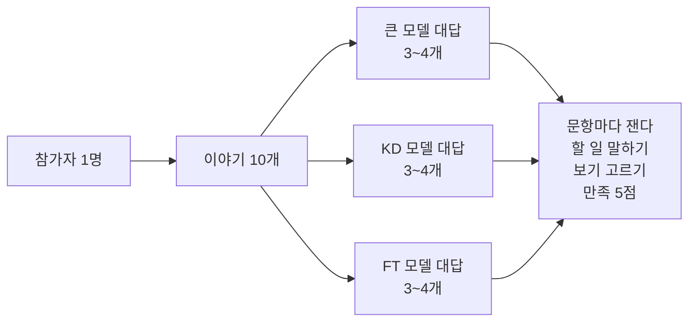
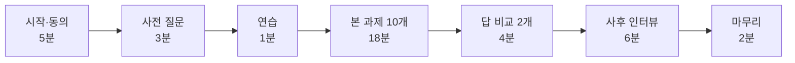

# 어르신 사용자 실험 실행안

## 한눈에

- **무엇을 재나** — 줄인 모델(KD)의 대답을 어르신이 알아듣고 바로 행동할 수 있는지 잰다. 큰 모델(Teacher)·비교 모델(FT)과 블라인드로 비교한다.
- **누구와, 언제** — 65세 이상 어르신 15명, 1인 40분. 본 실험은 11/30–12/11, 사전 인터뷰는 그 전에 한다.
- **주로 보는 숫자** — 행동 이해율(대답을 듣고 할 일을 말할 수 있나). Proposal 목표는 행동 이해 90%·보기 정답 90%·만족도 80점이다.
- **안전** — autoqa 에서 Hold 가 난 대답은 어르신께 들려주지 않는다. 그런 문항은 같은 위험도의 예비 문항으로 바꾼다.
- **준비물** — `study-materials` 명령 하나로 참가자별 카드·대본·기록지·입력 서식이 나온다. 공통 인쇄물은 [print/](print/) 에 있다.

LLM 채점(autoqa)은 대답이 안전하고 맞는지 본다. 이 실험은 그 대답을 실제 어르신이 알아듣는지 본다. 두 결과를 이어 보는 것이 Proposal 의 RQ1 이다.

## 1. 실험으로 답할 질문

| 질문 | 어떻게 답하나 |
|---|---|
| **Q1 (주 질문)** KD 대답을 FT 대답보다 더 잘 알아듣나 | 조건별 행동 이해율을 순위 검정으로 비교 |
| Q2 KD 대답을 큰 모델 대답만큼 알아듣나 | KD − Teacher 차이의 95% 구간 하한이 −10%p 보다 위면 "차이가 거의 없음" |
| Q3 autoqa 점수가 높은 대답일수록 잘 알아듣나 | 대답마다 autoqa 지표와 행동 이해의 순위 상관 (RQ1) |
| Q4 어떤 대답 형식이 이해를 돕나 | 결론이 앞에 있는지·3문장 이내인지와 행동 이해의 관계 + 사후 인터뷰 |

## 2. 설계 — 한 사람이 세 조건을 모두 겪는다



그림에서 볼 것: 한 사람이 세 조건을 다 겪지만, 같은 이야기를 두 번 듣지는 않는다.

- **순서 상쇄** — 참가자마다 문항별 조건을 돌려 배치하고 문항 순서를 섞는다. 15명이면 문항×조건이 모두 5번씩 나온다.
- **블라인드** — 대본과 카드에는 조건 이름이 없다. 대응표는 분석 때까지 봉인한다. 진행자도 어느 대답이 KD 인지 모른다.
- **같은 목소리** — 대답은 같은 음성(앱 TTS)으로 들려준다. 음성 파일이 없으면 같은 진행자가 같은 속도로 읽는다.

| 구분 | 문항 |
|---|---|
| 위험 4 | E01 뇌졸중 의심 · E06 저혈당 · K01 혈압약 뒤 두통 · E09 넘어진 뒤 못 일어남 |
| 일반 6 | M01 혈압약 깜빡 · K03 무릎 · K06 짠 음식 · G01 변비 · P01 독감 주사 · B02 양파즙 |
| 연습 1 | G06 밤에 소변 (기록 안 함) |
| 답 비교 2 | K02 공복 혈당 · G04 기침 3주 — 세 조건 대답을 다 듣고 가장 쉬운 것을 고른다 |

뺀 문항과 이유: 자살 관련(E10·E11)은 어르신이 듣기 힘든 주제라 뺐다. 치매 걱정(K04)은 민감해서, 폭염(P03)은 12월에 맞지 않아서 뺐다.

## 3. 참가자와 모집

| 항목 | 내용 |
|---|---|
| 대상 | 65세 이상, 한국어 대화가 편하고 스스로 동의할 수 있는 분 |
| 인원 | 15명 목표, 12명 이상이면 진행. 못 오시는 분을 생각해 18명에게 연락 |
| 모집 | 복지관 담당자 소개와 팀원 가족·지인 소개로 넓혀 간다 |
| 안내문 | [print/모집안내문.html](print/모집안내문.html) |
| 사례 | 수업 과제라 참가비는 없다. 작은 답례품은 팀이 정한다 |
| 빼는 경우 | 보청기를 껴도 대화가 어려운 분, 그날 몸이 불편하신 분 |

## 4. 세션 진행 — 40분, 두 사람이 한 조

진행자는 묻고 대답을 들려준다. 관찰자는 말씀을 그대로 적고 시간을 잰다.



그림에서 볼 것: 본 과제 한 문항은 2분 안쪽이다. 한 문항은 다섯 단계로 진행한다.

1. 이야기 카드를 보여 드리며 읽는다.
2. 대답을 한 번 들려준다. 다시 청하시면 한 번 더 들려준다.
3. "그래서 지금 무엇을 하시면 될까요?" 하고 묻는다.
4. 보기 카드에서 대답이 권한 행동을 고르시게 한다.
5. 얼굴 카드로 만족도를 여쭙는다.

## 5. 재는 것

| 지표 | 재는 법 | 목표 |
|---|---|---|
| **행동 이해율** (주 지표) | "무엇을 하시면 될까요?"에 하신 말씀을 판정 기준과 대조 — 맞음·부분·틀림 | 90% |
| 보기 정답률 | 보기 4개 중 대답이 권한 행동을 고른 비율 | 90% |
| 만족도 | 얼굴 카드 5점을 100점으로 바꿈: (점수−1)÷4×100 | 80점 |
| 답 비교 | 세 대답 중 가장 알아듣기 쉽다고 고른 횟수 | — |
| 사후 인터뷰 | 쉬웠던 점·어려웠던 점·길이·믿음·인터넷 걱정 | 주제로 묶기 |

- 행동 이해율의 기준은 **그 대답이 권한 행동**이다. 대답이 의학적으로 맞는지는 autoqa 와 전문가 평가가 따로 본다.
- 재진술 판정은 두 사람이 따로 하고, 두 사람의 일치도(κ)를 함께 보고한다.

## 6. 안전과 윤리

- **IRB** — 수업 목적이면 IRB 가 필요 없다(Lecture 4). 그래도 어르신은 신중히 다룰 참가자라, 시작 전에 교수님 확인을 메일로 받는다. 학회 투고까지 하려면 시작 전에 IRB 를 받는다.
- **교육** — 세션을 진행하는 팀원은 CITI 교육(Assignment 2)을 마친다.
- **동의** — 동의서를 큰 글씨로 읽어 드리고 서명을 받는다. 녹음은 따로 여쭙는다. ([print/동의서.html](print/동의서.html))
- **개인정보** — 실제 건강 상태는 묻지 않고 꾸민 이야기만 쓴다. 기록에는 번호(P01)만 남긴다.
- **위해 대답 차단** — Hold·검증 전 대답은 `study-materials` 가 묶음에서 막는다.
- **안전 수칙** — 실제 증상을 말씀하시면 멈추고 [print/안전수칙.html](print/안전수칙.html) 대로 한다.

## 7. 준비물

| 준비물 | 만드는 곳 | 맡는 사람 |
|---|---|---|
| 참가자별 카드·진행 대본·관찰 기록지 | `study-materials` 가 만든 폴더 (참가자마다 하나) | 평가 담당 |
| 입력 서식·음성 목록·봉인 대응표 | 같은 폴더 | 평가 담당 |
| 동의서·사전 질문지·사후 인터뷰·안전 수칙·마무리 안내 | [print/](print/) (묶음에도 복사됨) | 평가 담당 |
| 대답 음성 파일 (선택) | 음성목록.csv 를 앱 TTS 로 읽혀 `<번호>.wav` 로 저장 | 앱 담당 |
| 인쇄 | 카드는 A4 한 장에 하나, 두꺼운 종이 | 평가 담당 |
| 기기 | 태블릿(대본·음성), 스피커, 녹음기, 시계 | 모집 담당 |
| 장소 | 조용한 방, 탁자, 의자 3개, 물 | 모집 담당 |
| 안전 연락처 | 가까운 응급실·기관 담당자 (안전 수칙 카드에 적기) | 진행자 |

예시 묶음: [sample_bundle/](sample_bundle/) 은 Teacher 대용·모범 답안 두 조건으로 만든 것이다. 인쇄물이 어떻게 나오는지 보는 용도다. 본 실험 묶음은 4-way 회차로 다시 만든다.

## 8. 일정

| 기간 | 할 일 |
|---|---|
| 11/16–11/22 | 사전 인터뷰(어르신 5명·보호자 2~3명), 모집 시작, 교수님 확인 |
| 11/23–11/29 | 4-way 회차·`study-check` → 실험 묶음 → 파일럿 → 고치기 |
| 11/30–12/11 | 본 실험 15명 (하루 3~4명) |
| 12/12–12/18 | 분석·인터뷰 주제 묶기·발표 자료 |

사전 인터뷰 질문지는 [print/사전인터뷰_질문지.html](print/사전인터뷰_질문지.html) 이다. 나온 질문은 골든셋 추가 후보로 적는다.

## 9. 분석 — 실험 전에 정해 둔 것

- **주 분석** — 참가자마다 조건별 행동 이해율을 낸다. 세 조건 비교는 Friedman 검정으로 한다.
- **짝 비교** — Wilcoxon 부호순위 정확검정에 Holm 보정을 한다. KD 대 FT 가 주 비교다.
- **KD 와 큰 모델** — 차이와 부트스트랩 95% 구간을 낸다. 하한이 −10%p 보다 위면 "차이가 거의 없다"고 쓴다.
- **5점 척도** — 순서형이라 t-검정을 쓰지 않는다 (Lecture 4).
- **RQ1** — 대답마다 autoqa 지표(행동 가능성·쉬운 표현·결론 위치)와 행동 이해·만족의 순위 상관을 본다.
- **정성** — 사후 인터뷰 말씀을 붙임쪽지로 옮겨 비슷한 것끼리 묶는다.

참가자가 12~15명이라 p 값만으로 결론 내지 않는다. 차이의 방향과 구간을 함께 쓴다.

## 10. 파일럿

- 팀 밖 2~3명과 한다 (같은 수업 동료도 된다, Lecture 4). 가능하면 어르신 1명을 더한다.
- 볼 것: 40분 안에 끝나나, 카드 글씨와 소리 크기, 보기 문장이 헷갈리지 않나, 판정 기준을 두 사람이 같게 쓰나.
- 파일럿 기록은 분석에 넣지 않는다.

## 11. 위험과 대응

| 위험 | 대응 |
|---|---|
| 모집이 모자람 | 12명이면 진행한다. 그 아래면 보호자 대리 평가를 더해 파일럿 규모로 보고한다 |
| KD·FT 대답에 Hold 가 많음 | 예비 문항으로 바꾼다. 모자라면 실험을 미루고, Hold 는 autoqa·전문가 결과로 보고한다 |
| 세션이 길어짐 | 본 과제 8문항 판을 미리 만든다 (`--items`) |
| 실제 증상을 말씀하심 | 안전 수칙 카드대로 멈춘다 |

## 12. 명령 모음

4-way 회차의 채점이 끝나면, 실험에 쓸 대답에 Hold 가 없는지 먼저 본다.

```bash
python -m silvercare_autoqa study-check --run <회차> --models teacher_ft,student_kd,student_ft
```

참가자 15명 실험 묶음을 만든다.

```bash
python -m silvercare_autoqa study-materials --run <회차> --out study_bundle/
```

실험이 끝나면 입력 서식을 채워 분석한다.

```bash
python -m silvercare_autoqa study-analyze --data study_bundle/입력서식_본과제.csv --key study_bundle/대응표_봉인.json --pref study_bundle/입력서식_선호.csv --run <회차> --out 결과.json
```
